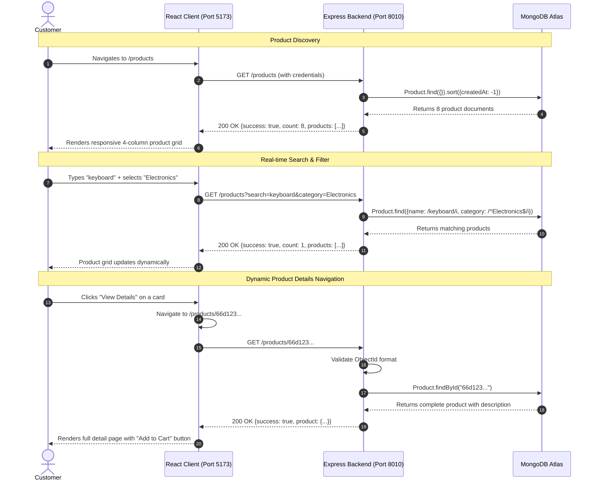

# ShopKart Lab 03 — Changes & Migration Walkthrough

This document outlines the **complete architectural and code evolution** from **Lab 02** (Customer Authentication & Protected Profile) to **Lab 03** (Product Catalog, Dynamic Routing, Search, Filtering & Discovery).

---

## Table of Contents
1. [Overview: What Changed from Lab 02 to Lab 03?](#1-overview-what-changed-from-lab-02-to-lab-03)
2. [File Tree Comparison (Lab 02 vs Lab 03)](#2-file-tree-comparison-lab-02-vs-lab-03)
3. [Backend Evolution](#3-backend-evolution)
4. [Frontend Evolution](#4-frontend-evolution)
5. [End-to-End Discovery Lifecycle (Sequence Diagram)](#5-end-to-end-discovery-lifecycle-sequence-diagram)
6. [API & Route Matrix](#6-api--route-matrix)
7. [Verification & Live Test Results](#7-verification--live-test-results)
8. [Lab 03 TA Viva Questions & Answers](#8-lab-03-ta-viva-questions--answers)

---

## 1. Overview: What Changed from Lab 02 to Lab 03?

| Dimension | Lab 02 (Completed Baseline) | Lab 03 (New Version) |
|---|---|---|
| **Core Goal** | Authenticate customer & protect `/home` | Dynamic product discovery, browsing & details |
| **Backend Models** | Only [`Customer`](file:///d:/Codes/Mern/shopkart%20PROJECT/backend/models/customer.model.js) | Added [`Product`](file:///d:/Codes/Mern/shopkart%20PROJECT/backend/models/product.model.js) model |
| **Backend APIs** | `/customers/register`, `/login`, `/me`, `/logout` | Added `POST /products`, `GET /products`, `GET /products/:id` |
| **Filtering & Search** | None | Real-time case-insensitive regex name search & category filtering |
| **Sorting** | None | Added `price_asc` and `price_desc` query sorting (Bonus Challenge) |
| **Frontend Pages** | `/register`, `/login`, `/home` | Added `/products` (Catalog Landing) and `/products/:id` (Details), converted Dashboard to `/profile` |
| **Route Parameters** | Static routes | Dynamic URL parameters using `useParams()` |
| **UI States Handled** | Auth Loading (`loading`) | 3 Catalog States: **Loading**, **Error (Retry)**, **Empty** |
| **Navigation** | Brand + Logout | Brand (to `/products`) + Products link + Profile link + Logout |

---

## 2. File Tree Comparison (Lab 02 vs Lab 03)

```diff
 shopkart PROJECT/
 ├── backend/
 │   ├── controllers/
 │   │   ├── customer.controller.js
+│   │   └── product.controller.js       # NEW: createProduct, getProducts, getProductById
 │   ├── models/
 │   │   ├── customer.model.js
+│   │   └── product.model.js            # NEW: Product Mongoose schema
 │   ├── routes/
 │   │   ├── customer.routes.js
+│   │   └── product.routes.js           # NEW: Express router for /products
 │   ├── utils/
 │   │   ├── generateToken.js
+│   │   └── seedProducts.js             # NEW: Database populator with 8 sample items
 │   └── index.js                        # MODIFIED: Mounted /products route
 │
 ├── frontend/
 │   └── src/
 │       ├── components/
 │       │   ├── Navbar.jsx              # MODIFIED: Brand links to /products, added Products & Profile tabs
+│       │   ├── ProductCard.jsx         # NEW: Dynamic product card with price in ₹ & stock badge
+│       │   └── SearchBar.jsx           # NEW: Search input + Category & Sort dropdowns
 │       ├── pages/
+│       │   ├── Home.jsx                # MODIFIED: Redirects to /profile
+│       │   ├── Profile.jsx             # NEW: Customer account & profile details page
 │       │   ├── Login.jsx               # MODIFIED: Navigates to /products on login
 │       │   ├── Register.jsx
+│       │   ├── Products.jsx            # NEW: Product catalog landing page with search & 3 states
+│       │   └── ProductDetails.jsx      # NEW: Dynamic page with useParams() & Add to Cart button
 │       └── App.jsx                     # MODIFIED: Root redirects to /products, registered /products & /profile
```

---

## 3. Backend Evolution

### 3.1 New Product Model ([`backend/models/product.model.js`](file:///d:/Codes/Mern/shopkart%20PROJECT/backend/models/product.model.js))
Enforces database constraints directly at the Mongoose layer:
- `name`: Required `String`, trimmed.
- `description`: Required `String`, trimmed.
- `price`: Required `Number`, `min: [0.01, 'Price must be greater than 0']`.
- `category`: Required `String`, trimmed.
- `image`: Required `String`, trimmed.
- `stock`: Required `Number`, `min: [0, 'Stock cannot be negative']`.
- `timestamps: true`: Auto-creates `createdAt` and `updatedAt`.

### 3.2 Product Controller Logic ([`backend/controllers/product.controller.js`](file:///d:/Codes/Mern/shopkart%20PROJECT/backend/controllers/product.controller.js))

#### A. Create Product (`POST /products` — Task 2)
- Validates all 6 fields. Returns `400 Bad Request` if price $\le 0$ or stock $< 0$.
- Returns `201 Created` with created product payload.

#### B. Dynamic Search & Category Filtering (`GET /products` — Task 3 & 5)
```javascript
// Case-insensitive search across name
if (search && search.trim() !== '') {
    query.name = { $regex: search.trim(), $options: 'i' }
}

// Category filter (omitted if 'All')
if (category && category.trim() !== '' && category.trim().toLowerCase() !== 'all') {
    query.category = { $regex: `^${category.trim()}$`, $options: 'i' }
}

// Price sorting (Bonus Challenge)
let sortOption = { createdAt: -1 }
if (sort === 'price_asc') sortOption = { price: 1 }
else if (sort === 'price_desc') sortOption = { price: -1 }

const products = await Product.find(query).select('name price category image stock').sort(sortOption)
```

#### C. Single Product Retrieval (`GET /products/:id` — Task 4)
- Validates `mongoose.Types.ObjectId.isValid(id)` $\rightarrow$ returns `400 Invalid product ID` if malformed.
- Queries `Product.findById(id)` $\rightarrow$ returns `404 Product not found` if not in database.
- Returns `200 OK` with full product details.

### 3.3 Route Mounting Diff ([`backend/index.js`](file:///d:/Codes/Mern/shopkart%20PROJECT/backend/index.js))
```diff
 import customerRoutes from './routes/customer.routes.js'
+import productRoutes from './routes/product.routes.js'

 // ... middlewares ...

 app.use('/customers', customerRoutes)
+app.use('/products', productRoutes)
```

---

## 4. Frontend Evolution

### 4.1 Reusable Discovery Components

#### 1. [`ProductCard.jsx`](file:///d:/Codes/Mern/shopkart%20PROJECT/frontend/src/components/ProductCard.jsx) (Task 6)
- Displays product image, category pill, name, price formatted in Indian Rupees (`₹${product.price.toLocaleString('en-IN')}`), dynamic stock indicator (`units left` or `Out of Stock`), and a "View Details" button.
- Clean Tailwind hover animation (`hover:-translate-y-1 hover:shadow-md transition-all`).

#### 2. [`SearchBar.jsx`](file:///d:/Codes/Mern/shopkart%20PROJECT/frontend/src/components/SearchBar.jsx) (Task 7)
- Three-column responsive grid containing:
  - Text input for keyword search with search icon.
  - Category dropdown (`All Categories`, `Electronics`, `Fashion`, `Books`, `Home`).
  - Sort dropdown (`Featured`, `Price: Low to High`, `Price: High to Low`).

### 4.2 New Discovery Pages

#### 1. [`Products.jsx`](file:///d:/Codes/Mern/shopkart%20PROJECT/frontend/src/pages/Products.jsx) (Tasks 6 & 7)
- Connects search and filter inputs with `api.get('/products', { params: { search, category, sort } })`.
- Includes **250ms debouncing** to prevent firing excessive HTTP requests on every single keystroke.
- Handles the **3 mandatory UI states**:
  1. **Loading State**: Animated spinner with `"Loading products..."`.
  2. **Error State**: Rose banner with `"Something went wrong while loading products."` and a functional **Retry** button.
  3. **Empty State**: Container with `"No products found."` and a **Clear Filters** button.

#### 2. [`ProductDetails.jsx`](file:///d:/Codes/Mern/shopkart%20PROJECT/frontend/src/pages/ProductDetails.jsx) (Task 8)
- Dynamic route using `useParams()`: `const { id } = useParams()`.
- Fetches `api.get('/products/' + id)`.
- Displays:
  - "Back to Products" breadcrumb link.
  - Large product image display.
  - Category and stock status pills.
  - Name, formatted price, and full description.
  - UI-only "Add to Cart" button with temporary feedback toast (ready for Lab 04 Cart integration).

### 4.3 App Routing & Navbar Updates

#### App Route Diff ([`frontend/src/App.jsx`](file:///d:/Codes/Mern/shopkart%20PROJECT/frontend/src/App.jsx)):
```diff
-import Home from './pages/Home'
+import Profile from './pages/Profile'
+import Products from './pages/Products'
+import ProductDetails from './pages/ProductDetails'

-  {/* Root redirect */}
-  <Route path="/" element={<Navigate to="/home" replace />} />
+  {/* Root redirect to Products landing page */}
+  <Route path="/" element={<Navigate to="/products" replace />} />

   {/* Public Routes */}
   <Route path="/register" element={<PublicRoute><Register /></PublicRoute>} />
   <Route path="/login" element={<PublicRoute><Login /></PublicRoute>} />

   {/* Protected Routes */}
+  <Route path="/products" element={<ProtectedRoute><Products /></ProtectedRoute>} />
+  <Route path="/products/:id" element={<ProtectedRoute><ProductDetails /></ProtectedRoute>} />
+  <Route path="/profile" element={<ProtectedRoute><Profile /></ProtectedRoute>} />
+  <Route path="/home" element={<Navigate to="/products" replace />} />
```

#### Navbar Navigation Diff ([`frontend/src/components/Navbar.jsx`](file:///d:/Codes/Mern/shopkart%20PROJECT/frontend/src/components/Navbar.jsx)):
```diff
-  <Link to="/home" className="flex items-center gap-2.5">
+  <Link to="/products" className="flex items-center gap-2.5">

+  {user && (
+    <nav className="flex items-center gap-1 sm:gap-2">
+      <Link to="/products" className="rounded-xl px-3 py-1.5 text-xs sm:text-sm font-semibold text-slate-600 hover:text-indigo-600">Products</Link>
+      <Link to="/profile" className="rounded-xl px-3 py-1.5 text-xs sm:text-sm font-semibold text-slate-600 hover:text-indigo-600">Profile</Link>
+    </nav>
+  )}

+  <Link to="/profile" className="hidden sm:flex flex-col text-right hover:opacity-80">
+    <span className="text-xs text-slate-400 font-medium">Logged in as</span>
+    <span className="text-sm font-semibold text-slate-800">{user.fullName}</span>
+  </Link>
```

---

## 5. End-to-End Discovery Lifecycle (Sequence Diagram)



---

## 6. API & Route Matrix

### Backend Endpoints
| Method | Route | Query Parameters | Description | Status Codes |
|---|---|---|---|---|
| `POST` | `/products` | — | Creates a new product | `201`, `400`, `500` |
| `GET` | `/products` | `search`, `category`, `sort` | Lists all products matching filters | `200`, `500` |
| `GET` | `/products/:id` | — | Retrieves single product by MongoDB ID | `200`, `400`, `404`, `500` |

### Frontend Routes
| Route | Page Component | Access | Purpose |
|---|---|---|---|
| `/products` | [`Products.jsx`](file:///d:/Codes/Mern/shopkart%20PROJECT/frontend/src/pages/Products.jsx) | Protected | Default landing & product discovery catalog |
| `/products/:id` | [`ProductDetails.jsx`](file:///d:/Codes/Mern/shopkart%20PROJECT/frontend/src/pages/ProductDetails.jsx) | Protected | Full product information & Add to Cart button |
| `/profile` | [`Profile.jsx`](file:///d:/Codes/Mern/shopkart%20PROJECT/frontend/src/pages/Profile.jsx) | Protected | Customer account & profile details |
| `/home` | Redirect | Protected | Redirects to `/products` |

---

## 7. Verification & Live Test Results

Every endpoint and component was verified against the running server:

1. **Get All Products**:
   ```bash
   GET http://localhost:8010/products
   # Result: 200 OK, count: 8 products returned
   ```
2. **Search by Name**:
   ```bash
   GET http://localhost:8010/products?search=keyboard
   # Result: 200 OK, count: 1 (Mechanical RGB Keyboard)
   ```
3. **Filter by Category**:
   ```bash
   GET http://localhost:8010/products?category=Fashion
   # Result: 200 OK, count: 2 (Denim Jacket, Leather Sneakers)
   ```
4. **Invalid ID Validation**:
   ```bash
   GET http://localhost:8010/products/invalid-id-123
   # Result: 400 Bad Request, message: "Invalid product ID"
   ```
5. **Frontend Build Verification**:
   ```bash
   npm run build
   # Result: 108 modules transformed, built in 1.54s without errors or warnings
   ```

---

## 8. Lab 03 TA Viva Questions & Answers

#### Q1: Why should product data come from MongoDB instead of being hardcoded in React?
> **Answer**: Hardcoding products inside React means any price update, inventory depletion, or product addition requires editing code, rebuilding, and redeploying the entire frontend. Storing product data in MongoDB allows inventory, pricing, and catalog updates to be managed dynamically in real-time through databases and admin APIs without altering client code.

#### Q2: What is the difference between a URL parameter and a query parameter?
> **Answer**:
> - **URL Parameter (`/products/:id`)**: Identifies a specific unique resource (e.g., product with ID `66d1...`). It forms part of the route path itself.
> - **Query Parameter (`/products?category=Electronics&search=phone`)**: Modifies, filters, sorts, or paginates a list of resources without changing the route endpoint.

#### Q3: When would you use `/products/:id` vs `/products?category=Electronics`?
> **Answer**: You use `/products/:id` when retrieving a single, canonical resource where you need all attributes (like descriptions, high-res photos, and inventory). You use query parameters like `?category=Electronics` when filtering or refining a collection of multiple resources.

#### Q4: How does `.map()` help us render products dynamically?
> **Answer**: In React, `.map()` iterates over an array of objects returned by an API and transforms each raw data object into a JSX element (e.g., `<ProductCard key={product._id} product={product} />`). This guarantees the UI automatically scales whether the backend returns 1, 10, or 100 products.

#### Q5: Why do we need loading, error, and empty states in a frontend application?
> **Answer**:
> 1. **Loading State**: Eliminates blank white screens and reassures users that their request is being processed.
> 2. **Error State**: Prevents application crashes and clearly explains to users what went wrong, often providing a "Retry" button.
> 3. **Empty State**: Differentiates between a system failure and a zero-result search, preventing confusion when filters return no matches.

#### Q6: What happens when the backend returns an empty array?
> **Answer**: The HTTP response status is still `200 OK` with `products: []`. If the frontend only checks for falsy values (`!products`), it might mistake `[]` for an error. Checking `products.length === 0` allows the frontend to render a dedicated, user-friendly Empty State (*"No products found"*).

#### Q7: Why should search/filtering be handled by the backend instead of filtering a huge dataset only in React?
> **Answer**: If an e-commerce catalog contains 500,000 products, downloading all 500,000 items to the user's browser would consume hundreds of megabytes of bandwidth, crash mobile browsers, and cause massive latency. MongoDB uses optimized B-tree indexes to filter millions of documents in milliseconds on the server and transmit only the matching 10-20 items over the network.

#### Q8: Why should API/service logic be separated from UI components?
> **Answer**: Separation of concerns allows UI components to focus strictly on layout and user experience, while network protocols, base URLs, and cookie credentials are abstracted in [`api.js`](file:///d:/Codes/Mern/shopkart%20PROJECT/frontend/src/services/api.js). If the API URL, headers, or authentication mechanism change, you update one service file without touching dozens of JSX components.
