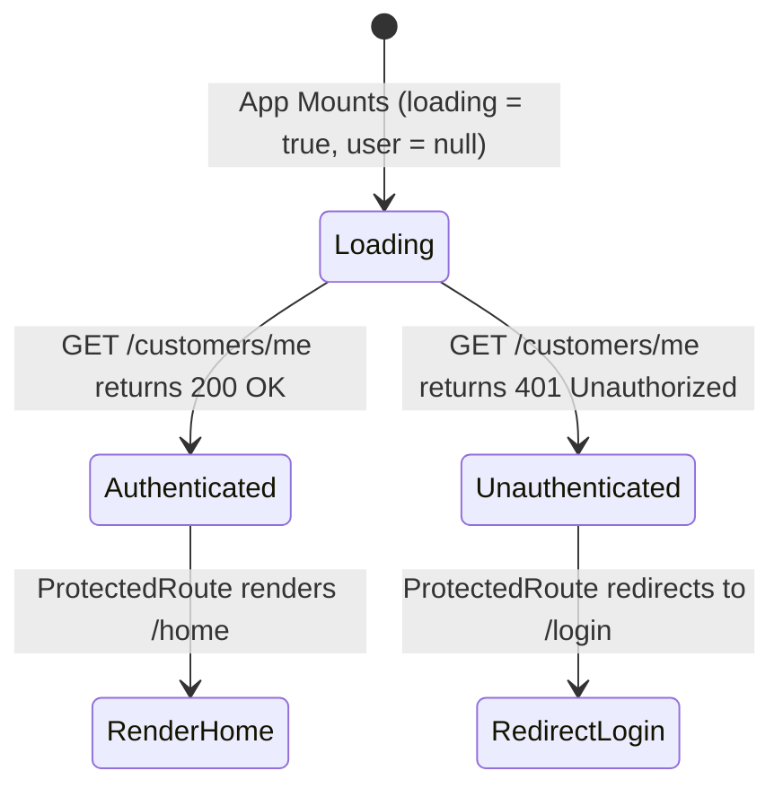

# ShopKart Frontend (Lab 02) — Complete Concepts & Syntax Guide

This comprehensive guide teaches **every single concept, pattern, hook, and syntax** used to build the ShopKart Frontend Authentication UI and Client-Server Integration. It is designed to take you from the fundamentals to deep conceptual mastery so you can explain every line in your lab evaluation and viva.

---

## Table of Contents
1. [Client-Server Architecture & CORS with Credentials](#1-client-server-architecture--cors-with-credentials)
2. [Single Page Applications (SPA) & Vite Build Tool](#2-single-page-applications-spa--vite-build-tool)
3. [Centralized HTTP Client: Axios Instance Configuration](#3-centralized-http-client-axios-instance-configuration)
4. [React Core Mechanics: Controlled Forms & State Management (`useState`)](#4-react-core-mechanics-controlled-forms--state-management-usestate)
5. [Client-Side Routing: React Router DOM v7](#5-client-side-routing-react-router-dom-v7)
6. [Global State Management: React Context API (`useContext`)](#6-global-state-management-react-context-api-usecontext)
7. [Route Guard Architecture: `ProtectedRoute` & `PublicRoute`](#7-route-guard-architecture-protectedroute--publicroute)
8. [Session Hydration Lifecycle (`useEffect` on Mount)](#8-session-hydration-lifecycle-useeffect-on-mount)
9. [HttpOnly Cookie Security: Why Client JS Cannot Touch Tokens](#9-httponly-cookie-security-why-client-js-cannot-touch-tokens)
10. [Modern UI Design System with Tailwind CSS v4](#10-modern-ui-design-system-with-tailwind-css-v4)
11. [Form Validation, Loading States & User Feedback](#11-form-validation-loading-states--user-feedback)
12. [TA Evaluation Rubric & Comprehensive Viva Q&A](#12-ta-evaluation-rubric--comprehensive-viva-qa)

---

## 1. Client-Server Architecture & CORS with Credentials

### 1.1 The Two Origins Problem
In modern web applications, the frontend client and the backend API run on completely different origins:

| Entity | URL | Origin Components |
|---|---|---|
| **Frontend (React/Vite)** | `http://localhost:5173` | Protocol: `http`, Host: `localhost`, Port: `5173` |
| **Backend (Express)** | `http://localhost:8010` | Protocol: `http`, Host: `localhost`, Port: `8010` |

Because the ports differ (`5173` vs `8010`), the browser enforces the **Same-Origin Policy (SOP)**. Any cross-origin AJAX/fetch request is blocked by default unless the backend explicitly enables **CORS (Cross-Origin Resource Sharing)**.

```text
Browser (Origin: http://localhost:5173)
       │
       │  Cross-Origin HTTP Request
       ▼
Express API (Origin: http://localhost:8010)
       │
       │  Must respond with:
       │  Access-Control-Allow-Origin: http://localhost:5173
       │  Access-Control-Allow-Credentials: true
       ▼
Browser receives response and permits JavaScript execution
```

### 1.2 The Role of `credentials: true` on Both Sides
By default, browsers **omit cookies and authorization headers** on cross-origin HTTP requests. To exchange session cookies across ports, **both** client and server must explicitly opt in:

1. **Backend ([`backend/index.js`](file:///d:/Codes/Mern/shopkart%20PROJECT/backend/index.js#L28-L33))**:
   ```javascript
   app.use(cors({
       origin: ['http://localhost:5173', 'http://localhost:5174'],
       credentials: true // Permits cookies to be set and received cross-origin
   }))
   ```
   > [!CRITICAL]
   > When `credentials: true` is enabled, the backend **CANNOT** use `origin: '*'`. The origin must be explicitly listed. If wildcard `*` is used, modern browsers will reject the response for security reasons.

2. **Frontend ([`frontend/src/services/api.js`](file:///d:/Codes/Mern/shopkart%20PROJECT/frontend/src/services/api.js#L3-L9))**:
   ```javascript
   export const api = axios.create({
       baseURL: 'http://localhost:8010',
       withCredentials: true // Instructs browser to attach cookies to outgoing requests
   })
   ```

---

## 2. Single Page Applications (SPA) & Vite Build Tool

### 2.1 Traditional Multi-Page App vs SPA

```text
Traditional Web App:
User clicks link ──► Browser makes full HTTP GET ──► Server returns new HTML ──► Full White Screen Reload

Single Page Application (SPA):
User clicks link ──► JS intercepts click ──► History API changes URL ──► React swaps Component (Instant!)
```

- In an SPA, the browser loads **one single HTML file** (`index.html`).
- Navigation does **not** trigger a page reload from the server.
- JavaScript dynamically destroys and mounts components into the DOM root (`<div id="root"></div>`).

### 2.2 Why Vite?
- **Vite** replaces legacy bundlers like Webpack (Create React App).
- Uses native browser **ES Modules (ESM)** in development, serving files on-demand without pre-bundling everything.
- Powered by **esbuild** (written in Go), resulting in sub-second server startup and instant Hot Module Replacement (HMR).

---

## 3. Centralized HTTP Client: Axios Instance Configuration

### 3.1 Why Centralize Axios?
Instead of calling raw `fetch()` or `axios.post('http://localhost:8010/customers/login', ...)` in every single component, we instantiate a centralized client inside [`src/services/api.js`](file:///d:/Codes/Mern/shopkart%20PROJECT/frontend/src/services/api.js).

### 3.2 Implementation & Syntax
```javascript
import axios from 'axios'

export const api = axios.create({
    baseURL: 'http://localhost:8010',
    headers: {
        'Content-Type': 'application/json',
    },
    withCredentials: true, // Automatically sends cookies on EVERY request
})

export default api
```

### 3.3 Benefits
- **Single Source of Truth**: If the backend port or domain changes (e.g., to production URL), you update **one line** in `api.js` instead of dozens of component files.
- **Uniform Cookie Handling**: Never risk forgetting `withCredentials: true` on an authenticated endpoint.
- **Response Parsing**: Unlike `fetch()`, Axios automatically transforms JSON responses (access via `response.data`) and throws errors on HTTP 4xx/5xx status codes for clean `try/catch` handling.

---

## 4. React Core Mechanics: Controlled Forms & State Management (`useState`)

### 4.1 Controlled vs Uncontrolled Components

| Feature | Controlled Component (Used in ShopKart) | Uncontrolled Component |
|---|---|---|
| **Data Holder** | React State (`useState`) | Direct DOM (`useRef` / HTML value) |
| **Source of Truth** | React Component State | The browser's native DOM element |
| **Instant Validation** | Yes (can validate on every keystroke) | No (only on submit) |
| **Synchronous Access** | State is always available immediately | Requires reading DOM node directly |

### 4.2 Generic Input Handler Pattern
Instead of writing separate `handleEmailChange`, `handlePasswordChange`, and `handlePhoneChange` functions, use a single computed property name handler:

```javascript
const [form, setForm] = useState({
    fullName: '',
    email: '',
    password: '',
    phone: ''
})

const handleChange = (e) => {
    // Computed property name [e.target.name] maps dynamically to state keys
    setForm((prev) => ({
        ...prev,
        [e.target.name]: e.target.value
    }))
}
```

```jsx
<input
    type="email"
    name="email" // Must match the state key
    value={form.email}
    onChange={handleChange}
/>
```

---

## 5. Client-Side Routing: React Router DOM v7

### 5.1 Core Components Breakdown

```jsx
import { BrowserRouter, Routes, Route, Navigate } from 'react-router-dom'
```

1. **`<BrowserRouter>`**:
   Wraps the entire application. Uses the HTML5 History API (`pushState`, `replaceState`, `popstate`) to keep the UI in sync with the browser's URL address bar without page reloads.

2. **`<Routes>`**:
   Acts as an intelligent switcher. Scans all child `<Route>` definitions and renders only the best matching component.

3. **`<Route path="..." element={...} />`**:
   Associates a URL pathname to a specific React component.

4. **`<Navigate to="..." replace />`**:
   Declarative programmatic redirect.
   - `to`: Target URL path.
   - `replace`: Replaces the current entry in the history stack instead of pushing a new one (prevents the user from hitting the "Back" button into a redirected route).

5. **`useNavigate()` Hook**:
   Imperative navigation function for event handlers:
   ```javascript
   const navigate = useNavigate()
   navigate('/login') // Pushes /login to history
   ```

---

## 6. Global State Management: React Context API (`useContext`)

### 6.1 The Problem: "Prop Drilling"
If user session data is needed by `Navbar`, `Home`, and `ProtectedRoute`, passing `user` down through 5 layers of component props is messy and unmaintainable.

```text
Prop Drilling (Bad):
App ──► Layout (doesn't need user) ──► Header (doesn't need user) ──► Navbar (needs user)

React Context API (Clean):
       ┌────────────────────────┐
       │   AuthProvider State   │
       └───────────┬────────────┘
         ▲         │          ▲
         │         ▼          │
      Navbar     Home    ProtectedRoute
      (Any component can read user directly!)
```

### 6.2 Context Implementation Architecture

#### Step 1: Create Context & Provider ([`src/context/AuthContext.jsx`](file:///d:/Codes/Mern/shopkart%20PROJECT/frontend/src/context/AuthContext.jsx))
```javascript
import { createContext, useContext, useEffect, useState } from 'react'
import { api } from '../services/api'

const AuthContext = createContext()

export const AuthProvider = ({ children }) => {
    const [user, setUser] = useState(null)
    const [loading, setLoading] = useState(true)

    const fetchUser = async () => {
        try {
            const response = await api.get('/customers/me')
            setUser(response.data) // Populates { _id, fullName, email, phone }
        } catch {
            setUser(null)
        } finally {
            setLoading(false)
        }
    }

    useEffect(() => {
        fetchUser()
    }, [])

    return (
        <AuthContext.Provider value={{ user, setUser, loading, fetchUser }}>
            {children}
        </AuthContext.Provider>
    )
}

// Custom hook for convenient consumption
export const useAuth = () => useContext(AuthContext)
```

#### Step 2: Consume Anywhere in the App
```javascript
const { user, setUser } = useAuth()
```

---

## 7. Route Guard Architecture: `ProtectedRoute` & `PublicRoute`

### 7.1 Protected Route Guard ([`src/components/ProtectedRoute.jsx`](file:///d:/Codes/Mern/shopkart%20PROJECT/frontend/src/components/ProtectedRoute.jsx))
Protects private pages (like `/home`). Prevents unauthenticated guests from viewing customer data.

```jsx
import { Navigate } from 'react-router-dom'
import { useAuth } from '../context/AuthContext'

function ProtectedRoute({ children }) {
    const { user, loading } = useAuth()

    // 1. MUST wait while authentication status is being checked
    if (loading) {
        return <div>Loading ShopKart...</div>
    }

    // 2. If unauthenticated, redirect to login
    if (!user) {
        return <Navigate to="/login" replace />
    }

    // 3. User is verified, render protected children
    return children
}
```

### 7.2 Public Route Guard ([`src/components/PublicRoute.jsx`](file:///d:/Codes/Mern/shopkart%20PROJECT/frontend/src/components/PublicRoute.jsx))
Protects guest pages (like `/login` and `/register`). Prevents already-logged-in users from seeing login forms again.

```jsx
function PublicRoute({ children }) {
    const { user, loading } = useAuth()

    if (loading) {
        return <div>Loading ShopKart...</div>
    }

    // If already logged in, redirect directly to /home
    if (user) {
        return <Navigate to="/home" replace />
    }

    return children
}
```

---

## 8. Session Hydration Lifecycle (`useEffect` on Mount)

### 8.1 The "Flicker" Problem & Why `loading` State is Mandatory

```text
WITHOUT loading state:
1. App boots: user is initially null.
2. ProtectedRoute checks user: sees null!
3. ProtectedRoute immediately redirects user to /login!
4. 200ms later: /customers/me responds with valid user data.
Result: The user was logged in, but got booted to /login by mistake! (Flash/Flicker Bug)
```

### 8.2 The Solution: The 3-State Lifecycle



1. **State 1: `loading = true`**:
   The application displays a clean loading spinner while the browser verifies the cookie with the server.
2. **State 2: `loading = false, user = customer`**:
   Cookie verified! `ProtectedRoute` grants access.
3. **State 3: `loading = false, user = null`**:
   No cookie or expired! `ProtectedRoute` redirects to `/login`.

---

## 9. HttpOnly Cookie Security: Why Client JS Cannot Touch Tokens

### 9.1 Comparison: `localStorage` vs `HttpOnly Cookie`

| Criterion | `localStorage` | `HttpOnly` Cookie (ShopKart Architecture) |
|---|---|---|
| **JavaScript Accessible?** | **YES** (`localStorage.getItem('token')`) | **NO** (`document.cookie` cannot see it) |
| **XSS Vulnerability** | **Extremely Vulnerable**. Any malicious npm package or script can steal tokens. | **Immune**. Browser does not expose cookie to JS. |
| **Transmission** | Manual header attachment (`Authorization: Bearer ...`) | **Automatic**. Browser attaches it to every request to the backend domain. |
| **CSRF Protection** | Naturally immune (unless XSS is present). | Protected via `SameSite: 'lax'` attribute. |
| **Expiration Control** | Manual client-side parsing and deletion. | Native browser expiration via `Max-Age` / `Expires`. |

### 9.2 The "Invisible Cookie" Mental Model
In ShopKart:
- You will **never** see code like `const token = ...` in the React frontend.
- When you log in, the server sends `Set-Cookie: token=...; HttpOnly`.
- The browser stores this internally in its secure storage.
- When calling `api.get('/customers/me')`, Axios (with `withCredentials: true`) tells the browser: *"Attach stored cookies for port 8010."*
- The server verifies the token and returns user profile data.
- **Client JavaScript never handles, sees, or stores the raw token.**

---

## 10. Modern UI Design System with Tailwind CSS v4

### 10.1 Vite + Tailwind v4 Setup
Tailwind CSS v4 introduces a streamlined CSS-first architecture. It does not require `tailwind.config.js` or `postcss.config.js`:

1. **Vite Plugin ([`vite.config.js`](file:///d:/Codes/Mern/shopkart%20PROJECT/frontend/vite.config.js))**:
   ```javascript
   import tailwindcss from '@tailwindcss/vite'
   export default defineConfig({
       plugins: [react(), tailwindcss()],
   })
   ```
2. **CSS Entry ([`src/index.css`](file:///d:/Codes/Mern/shopkart%20PROJECT/frontend/src/index.css))**:
   ```css
   @import "tailwindcss";
   ```

### 10.2 Aesthetic Design Tokens Used in ShopKart
To match `social_media_C_2029`:
- **Background**: `bg-slate-50` (soft, professional neutral).
- **Cards**: `bg-white rounded-3xl p-8 shadow-sm border border-slate-100` (premium curved container).
- **Primary Brand**: `bg-indigo-600 hover:bg-indigo-700 shadow-md shadow-indigo-200` (vibrant modern indigo).
- **Form Inputs**: `rounded-xl border border-slate-200 bg-slate-50/50 px-4 py-3 text-slate-800 text-sm focus:border-indigo-500 focus:bg-white focus:ring-4 focus:ring-indigo-500/10`.
- **Status Badges**: `rounded-full bg-emerald-50 px-2.5 py-0.5 text-xs font-semibold text-emerald-700 border border-emerald-100`.

---

## 11. Form Validation, Loading States & User Feedback

### 11.1 Client-Side Validation Rules
Always validate client-side **before** hitting the network to provide instant feedback and save server resources:

```javascript
// 1. Mandatory field check
if (!form.fullName.trim() || !form.email.trim() || !form.password || !form.phone.trim()) {
    setErrorMsg('Please fill in all fields.')
    return
}

// 2. Minimum length check
if (form.password.length < 6) {
    setErrorMsg('Password must be at least 6 characters long.')
    return
}
```

### 11.2 The Async Submission Pattern (`loader` state)
To prevent duplicate clicks and provide user feedback:
```javascript
const handleSubmit = async (e) => {
    e.preventDefault()
    setLoader(true)
    setErrorMsg('')

    try {
        await api.post('/customers/register', form)
        navigate('/login')
    } catch (error) {
        setErrorMsg(error.response?.data?.message || 'Registration failed.')
    } finally {
        setLoader(false) // Always reset in finally block!
    }
}
```

---

## 12. TA Evaluation Rubric & Comprehensive Viva Q&A

### 12.1 Evaluation Rubric (100 Marks)
| Category | Marks | Verified In Project |
|---|---|---|
| **Registration UI + API** | 25 | [`Register.jsx`](file:///d:/Codes/Mern/shopkart%20PROJECT/frontend/src/pages/Register.jsx) controlled form, validation, calls `POST /customers/register`. |
| **Login UI + API** | 25 | [`Login.jsx`](file:///d:/Codes/Mern/shopkart%20PROJECT/frontend/src/pages/Login.jsx) controlled form, invalid credentials handling, calls `POST /customers/login`. |
| **Protected Home Page** | 20 | [`Home.jsx`](file:///d:/Codes/Mern/shopkart%20PROJECT/frontend/src/pages/Home.jsx) displays Name, Email, Phone, Customer ID. Guarded by `ProtectedRoute`. |
| **Logout Functionality** | 10 | [`Navbar.jsx`](file:///d:/Codes/Mern/shopkart%20PROJECT/frontend/src/components/Navbar.jsx) calls `POST /customers/logout`, clears session state, redirects to `/login`. |
| **Routing** | 10 | [`App.jsx`](file:///d:/Codes/Mern/shopkart%20PROJECT/frontend/src/App.jsx) configured with `BrowserRouter`, `PublicRoute`, and `ProtectedRoute`. |
| **UI & Code Quality** | 10 | Modular components, centralized Axios, clean Tailwind CSS v4 design. |

---

### 12.2 Comprehensive Viva Questions & Model Answers

#### Q1: Why do we set `withCredentials: true` in our Axios instance?
> **Answer**: By default, browsers enforce CORS restrictions that strip cookies and credentials from cross-origin requests (`http://localhost:5173` to `http://localhost:8010`). Setting `withCredentials: true` explicitly instructs the browser to include our `HttpOnly` JWT cookie with outgoing HTTP requests to the backend. Without this, `/customers/me` would receive no cookie and respond with `401 Unauthorized`.

#### Q2: Why can't client-side JavaScript read or write an `HttpOnly` cookie?
> **Answer**: `HttpOnly` is a security flag set by the server in the `Set-Cookie` header. It tells the browser that this cookie must **never** be accessible through the JavaScript DOM API (`document.cookie`). This mitigates **Cross-Site Scripting (XSS)** attacks: even if an attacker injects a malicious script onto the page, they cannot steal the user's session token.

#### Q3: Why is `/home` called a "Protected Route"?
> **Answer**: Unlike public routes (like `/login` or `/register`), `/home` contains private user data and must not be accessible to unauthenticated visitors. It is wrapped in a `<ProtectedRoute>` component that verifies whether an authenticated `user` exists in `AuthContext`. If no session is active, it blocks access and redirects the visitor to `/login`.

#### Q4: Why do we fetch `/customers/me` on mount instead of storing the user in `localStorage`?
> **Answer**:
> 1. **Security**: Data in `localStorage` is accessible to any script running on the page, making it susceptible to XSS token theft.
> 2. **Single Source of Truth**: `localStorage` can easily desynchronize from the database (e.g. if the user is deleted, suspended, or their token expires). Calling `GET /customers/me` forces verification against the backend on every page refresh.

#### Q5: What is the difference between Authentication and Authorization?
> **Answer**:
> - **Authentication (AuthN)**: Verifying **who** a user is (e.g., verifying email and password on `/customers/login` and issuing a token).
> - **Authorization (AuthZ)**: Verifying **what permissions** an authenticated user has (e.g., determining whether user Jane can delete a product or access an admin panel).

#### Q6: What does the `replace` prop on `<Navigate to="/login" replace />` do?
> **Answer**: The `replace` prop instructs React Router to **replace** the current entry in the browser's history stack instead of pushing a new one. This prevents an infinite redirect loop when the user clicks the browser's "Back" button.

#### Q7: Why is a `loading` state necessary inside `AuthContext`?
> **Answer**: In React, state initialization is asynchronous. When the application first mounts, `user` defaults to `null` while the HTTP request to `/customers/me` is in-flight. Without a `loading` flag, `ProtectedRoute` would see `user === null` and prematurely redirect an authenticated user to `/login` before the backend has a chance to respond.

#### Q8: What happens behind the scenes when the user clicks "Logout"?
> **Answer**:
> 1. The click triggers `handleLogout` in `Navbar.jsx`.
> 2. An HTTP `POST` request is sent to `/customers/logout`.
> 3. The backend Express server calls `res.clearCookie('token')`, instructing the browser to delete the cookie.
> 4. The React client clears `user` state (`setUser(null)`).
> 5. React Router navigates the user back to `/login`.

#### Q9: What is the difference between a Controlled and Uncontrolled component in React?
> **Answer**: In a **controlled component**, the input value is bound to React state (`value={form.email}`) and updated via an `onChange` handler, making React the single source of truth. In an **uncontrolled component**, the DOM itself maintains the input's state, and values are pulled imperatively via a `ref` on form submission.

#### Q10: Why must `cors` on the backend NOT use `origin: '*'` when using cookies?
> **Answer**: The CORS specification forbids the wildcard `origin: '*'` when `credentials: true` is enabled. The browser will deliberately reject any response combining both, because allowing any arbitrary website to make authenticated requests with cookies would create a massive security vulnerability. The backend must explicitly whitelist approved origins.
