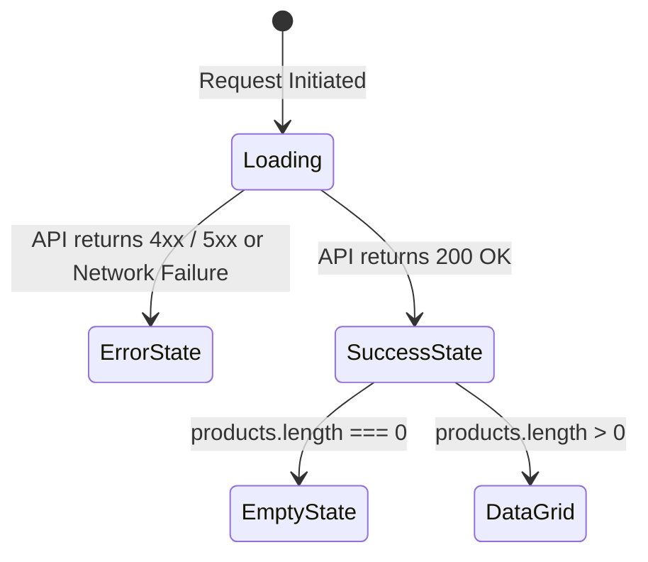

# ShopKart Product Catalog (Lab 03) — Complete Concepts & Syntax Guide

This comprehensive guide teaches **every single concept, pattern, database query, hook, and architectural principle** used to build the ShopKart Product Catalog and Discovery experience. It is designed to take you from the fundamentals to deep conceptual mastery so you can explain every line in your lab evaluation and viva.

---

## Table of Contents
1. [The Paradigm Shift: From Hardcoded UI to Data-Driven Applications](#1-the-paradigm-shift-from-hardcoded-ui-to-data-driven-applications)
2. [E-Commerce Data Modeling with Mongoose](#2-e-commerce-data-modeling-with-mongoose)
3. [Dynamic MongoDB Query Building & Operators](#3-dynamic-mongodb-query-building--operators)
4. [MongoDB ObjectId Mechanics & ID Validation](#4-mongodb-objectid-mechanics--id-validation)
5. [URL Route Parameters vs HTTP Query Parameters](#5-url-route-parameters-vs-http-query-parameters)
6. [Dynamic List Rendering in React with `.map()` & Keys](#6-dynamic-list-rendering-in-react-with-map--keys)
7. [Dynamic Routing with `useParams()` in React Router DOM](#7-dynamic-routing-with-useparams-in-react-router-dom)
8. [The 3 Mandatory Frontend UI States (Loading, Error, Empty)](#8-the-3-mandatory-frontend-ui-states-loading-error-empty)
9. [Debouncing Real-Time Search Inputs](#9-debouncing-real-time-search-inputs)
10. [Server-Side vs Client-Side Filtering: Scalability Analysis](#10-server-side-vs-client-side-filtering-scalability-analysis)
11. [Component Modularity & Responsive Grid Design](#11-component-modularity--responsive-grid-design)
12. [TA Evaluation Rubric & Comprehensive Viva Q&A](#12-ta-evaluation-rubric--comprehensive-viva-qa)

---

## 1. The Paradigm Shift: From Hardcoded UI to Data-Driven Applications

### 1.1 Why Hardcoding Data in React Fails in Production
In introductory frontend projects, students often hardcode mock product arrays directly into JSX:

```jsx
// ❌ WRONG: Hardcoded in React
const PRODUCTS = [
    { id: 1, name: "Headphones", price: 4999 },
    { id: 2, name: "Keyboard", price: 2999 }
]
```

This violates the fundamentals of real-world software engineering:
1. **No Shared State**: If an admin changes a price or a customer purchases the last remaining unit, other users will still see outdated information.
2. **Re-deployment Required**: Changing a product description requires editing code, running a build, and redeploying the client bundle.
3. **No Persistence**: Cart actions, inventory deductions, and order records cannot exist without a central database.

### 1.2 The Data-Driven Client-Server Model
In Lab 03, MongoDB becomes the **single source of truth**:

```text
MongoDB (Single Source of Truth)
       │
       ▼
Express REST API (Business rules & dynamic filtering)
       │ JSON Response
       ▼
React Client (Stateless rendering via useState & useEffect)
```

- The React client knows **nothing** about products ahead of time.
- On mount, React asks the backend: *"What products exist matching these filters?"*
- The backend queries MongoDB and responds with pure JSON.
- React dynamically maps that JSON into interactive DOM nodes.

---

## 2. E-Commerce Data Modeling with Mongoose

### 2.1 Schema Design & Field Constraints ([`backend/models/product.model.js`](file:///d:/Codes/Mern/shopkart%20PROJECT/backend/models/product.model.js))

```javascript
import mongoose from 'mongoose'

const productSchema = new mongoose.Schema(
    {
        name: {
            type: String,
            required: [true, 'Product name is required'],
            trim: true
        },
        description: {
            type: String,
            required: [true, 'Product description is required'],
            trim: true
        },
        price: {
            type: Number,
            required: [true, 'Product price is required'],
            min: [0.01, 'Price must be greater than 0'] // Enforces strictly positive values
        },
        category: {
            type: String,
            required: [true, 'Product category is required'],
            trim: true
        },
        image: {
            type: String,
            required: [true, 'Product image URL is required'],
            trim: true
        },
        stock: {
            type: Number,
            required: [true, 'Product stock is required'],
            min: [0, 'Stock cannot be negative'] // Prevents negative inventory
        }
    },
    {
        timestamps: true // Automatically creates 'createdAt' and 'updatedAt'
    }
)

const Product = mongoose.model('Product', productSchema)
export default Product
```

### 2.2 Why Schema Validation Matters
Even if the frontend has form checks, attackers can bypass the client and send raw HTTP requests directly to `POST /products`. Schema validations in Mongoose act as an impenetrable **database firewall**:
- `min: [0.01]`: Prevents free or negative-priced exploits.
- `min: [0]`: Prevents inventory underflow bugs where stock drops below zero.
- `trim: true`: Automatically strips extraneous leading and trailing whitespace from strings (`"  Electronics  "` $\rightarrow$ `"Electronics"`).

---

## 3. Dynamic MongoDB Query Building & Operators

### 3.1 The Problem: Avoid Writing Multiple Endpoints
Beginner developers often make the mistake of creating separate routes for every filter:
- `GET /products/search`
- `GET /products/category`
- `GET /products/category-and-search`

This is unmaintainable. Instead, we use **Dynamic Query Objects** in a single endpoint (`GET /products`).

### 3.2 Dynamic Query Pattern in Controller ([`backend/controllers/product.controller.js`](file:///d:/Codes/Mern/shopkart%20PROJECT/backend/controllers/product.controller.js#L58-L86))

```javascript
export const getProducts = async (req, res) => {
    try {
        const { search, category, sort } = req.query

        // 1. Initialize empty query object
        const query = {}

        // 2. Conditionally add search filter (Case-Insensitive Regex)
        if (search && search.trim() !== '') {
            query.name = { $regex: search.trim(), $options: 'i' }
        }

        // 3. Conditionally add category filter (Exact match)
        if (category && category.trim() !== '' && category.trim().toLowerCase() !== 'all') {
            query.category = { $regex: `^${category.trim()}$`, $options: 'i' }
        }

        // 4. Determine sorting order (Bonus Challenge)
        let sortOption = { createdAt: -1 } // Default: newest first
        if (sort === 'price_asc') {
            sortOption = { price: 1 }      // Ascending (lowest price first)
        } else if (sort === 'price_desc') {
            sortOption = { price: -1 }     // Descending (highest price first)
        }

        // 5. Execute query with field projection
        const products = await Product.find(query)
            .select('name price category image stock')
            .sort(sortOption)

        return res.status(200).json({
            success: true,
            count: products.length,
            products
        })
    } catch (error) {
        return res.status(500).json({ success: false, message: 'Internal Server Error' })
    }
}
```

### 3.3 MongoDB Query Operators Explained

| Operator | Syntax | Purpose |
|---|---|---|
| **`$regex`** | `{ name: { $regex: 'phone' } }` | Matches strings containing the substring `"phone"`. |
| **`$options: 'i'`** | `{ $options: 'i' }` | Makes regular expression matching case-insensitive (`"PHONE"`, `"Phone"`, `"phone"` all match). |
| **`^` and `$`** | `{ category: { $regex: '^Electronics$' } }` | Anchors to beginning and end of string, enforcing exact whole-word matching while preserving case-insensitivity. |
| **`.select()`** | `.select('name price category image stock')` | **Projection**: Instructs MongoDB to omit unneeded fields (like lengthy descriptions or internal metadata) to save network bandwidth. |
| **`.sort()`** | `.sort({ price: 1 })` | `1` indicates ascending order; `-1` indicates descending order. |

---

## 4. MongoDB ObjectId Mechanics & ID Validation

### 4.1 What is an ObjectId?
In MongoDB, primary keys (`_id`) are not auto-incrementing numbers (like `1, 2, 3`). They are 12-byte BSON types represented as **24-character hexadecimal strings**:

```text
507f1f77bcf86cd799439011
│───────│──────│────│──────│
 4 bytes 3 bytes 2 bytes 3 bytes
Timestamp Machine Process Counter
```

### 4.2 The "CastError" Crash & Prevention
If a user requests `GET /products/123` or `GET /products/invalid-id`, passing a malformed string directly into `Product.findById(id)` causes Mongoose to throw an unhandled `CastError`, crashing the request:

```text
Cast to ObjectId failed for value "123" at path "_id" for model "Product"
```

### 4.3 Safe ID Validation Pattern ([`product.controller.js`](file:///d:/Codes/Mern/shopkart%20PROJECT/backend/controllers/product.controller.js#L107-L125))

```javascript
import mongoose from 'mongoose'

export const getProductById = async (req, res) => {
    const { id } = req.params

    // Step 1: Pre-validate that ID is a valid 24-character hexadecimal
    if (!mongoose.Types.ObjectId.isValid(id)) {
        return res.status(400).json({
            success: false,
            message: 'Invalid product ID' // 400 Bad Request
        })
    }

    // Step 2: Query database
    const product = await Product.findById(id)

    // Step 3: Handle resource not found
    if (!product) {
        return res.status(404).json({
            success: false,
            message: 'Product not found' // 404 Not Found
        })
    }

    // Step 4: Return resource
    return res.status(200).json({ success: true, product })
}
```

---

## 5. URL Route Parameters vs HTTP Query Parameters

Understanding the fundamental distinction between route parameters and query parameters is a favorite TA viva question:

| Dimension | URL Route Parameter (`req.params`) | HTTP Query Parameter (`req.query`) |
|---|---|---|
| **Example URL** | `http://localhost:8010/products/66d123abc456` | `http://localhost:8010/products?category=Electronics&sort=price_asc` |
| **Syntactic Marker** | Embedded directly in the path (`/:id`) | Follows the `?` question mark and delimited by `&` |
| **Express Access** | `req.params.id` | `req.query.category`, `req.query.sort` |
| **React Router Access** | `const { id } = useParams()` | `const [searchParams] = useSearchParams()` or direct state |
| **Semantic Meaning** | **Resource Identification**: Identifies *which* unique resource is requested. | **Resource Modifier**: Filters, sorts, searches, or paginates a collection. |
| **Optional?** | Mandatory (path fails to match without it). | Completely optional (endpoint works fine without queries). |

---

## 6. Dynamic List Rendering in React with `.map()` & Keys

### 6.1 The `.map()` Functional Transformation Pattern
React JSX does not have traditional `for` or `while` loops. Instead, we use JavaScript's functional `.map()` method to transform an array of data objects into an array of JSX elements:

```jsx
{products.map((product) => (
    <ProductCard key={product._id} product={product} />
))}
```

### 6.2 Why the `key` Prop is Mandatory

```text
Without Key:
Old: [ Card A, Card B, Card C ]
New: [ Card B, Card C ]
React has to re-evaluate and re-render the entire DOM list!

With Key (key={product._id}):
Old: [ A(id:1), B(id:2), C(id:3) ]
New: [ B(id:2), C(id:3) ]
React instantly identifies: "Card A was deleted. Leave Card B and C untouched in the DOM!"
```

- React uses the `key` prop for its **Virtual DOM Reconciliation** algorithm.
- It identifies which items in a list have changed, been added, or been removed.
- **Never use array index (`key={index}`)** for items that can be sorted, filtered, or deleted; doing so leads to subtle visual bugs and input state bleeding. Always use stable, unique database identifiers like `product._id`.

---

## 7. Dynamic Routing with `useParams()` in React Router DOM

### 7.1 Defining Dynamic Routes in `App.jsx` ([`frontend/src/App.jsx`](file:///d:/Codes/Mern/shopkart%20PROJECT/frontend/src/App.jsx#L47-L55))

The colon (`:`) denotes a dynamic URL parameter placeholder:

```jsx
<Route
    path="/products/:id"
    element={
        <ProtectedRoute>
            <ProductDetails />
        </ProtectedRoute>
    }
/>
```

When a user visits `/products/66d123abc456`, React Router matches this route and assigns `"66d123abc456"` to the key `id`.

### 7.2 Consuming Parameters in `ProductDetails.jsx` ([`frontend/src/pages/ProductDetails.jsx`](file:///d:/Codes/Mern/shopkart%20PROJECT/frontend/src/pages/ProductDetails.jsx#L6-L26))

```javascript
import { useParams } from 'react-router-dom'
import { api } from '../services/api'

function ProductDetails() {
    // Extracts whatever value was in the :id portion of the URL
    const { id } = useParams()
    const [product, setProduct] = useState(null)

    useEffect(() => {
        const fetchProduct = async () => {
            const response = await api.get(`/products/${id}`)
            setProduct(response.data.product)
        }

        fetchProduct()
    }, [id]) // Re-run effect if the user navigates directly to another product ID
```

---

## 8. The 3 Mandatory Frontend UI States (Loading, Error, Empty)

A professional web application must **never** show a blank white screen while asynchronous operations occur. There are three mandatory states in any data-driven interface:



### 8.1 State 1: Loading State
- **Trigger**: `loading === true`.
- **UI**: Clean spinner or animated skeleton container.
- **Purpose**: Informs user that the network request is currently in-flight.
```jsx
{loading && (
    <div className="flex flex-col items-center justify-center p-12">
        <div className="h-9 w-9 animate-spin rounded-full border-4 border-indigo-600 border-t-transparent"></div>
        <p className="mt-4 text-sm font-medium text-slate-600">Loading products...</p>
    </div>
)}
```

### 8.2 State 2: Error State
- **Trigger**: `!loading && error !== ''`.
- **UI**: Distinct warning banner with an actionable **"Retry"** button.
- **Purpose**: Catches dropped connections, server crashes, or timeouts gracefully without freezing the UI.

### 8.3 State 3: Empty State
- **Trigger**: `!loading && !error && products.length === 0`.
- **UI**: Friendly empty inbox icon with `"No products found."` and a **"Clear Filters"** button.
- **Purpose**: Explicitly tells the user that the query succeeded, but zero records matched their criteria.

---

## 9. Debouncing Real-Time Search Inputs

### 9.1 The Problem: Network Flooding

If a user types the word `"Headphones"` (10 keystrokes):
- **Without Debounce**: 10 separate HTTP requests are fired in less than 2 seconds (`/products?search=H`, `/products?search=He`, ...).
- **Consequence**: Wasteful server CPU load, race conditions (where earlier slower requests overwrite later responses), and sluggish mobile performance.

### 9.2 The Solution: Debounce with `useEffect` Cleanup ([`frontend/src/pages/Products.jsx`](file:///d:/Codes/Mern/shopkart%20PROJECT/frontend/src/pages/Products.jsx#L34-L41))

```javascript
useEffect(() => {
    // 1. Set a timer to execute the fetch after 250ms of typing inactivity
    const delayDebounce = setTimeout(() => {
        fetchProducts()
    }, 250)

    // 2. Cleanup function: If the user types another letter within 250ms,
    // the previous timer is cancelled before it ever fires!
    return () => clearTimeout(delayDebounce)
}, [search, category, sort])
```

```text
User types 'k' ──► Timer starts (250ms)
User types 'e' (after 50ms) ──► Cleanup cancels timer 1! ──► Timer 2 starts (250ms)
User stops typing ──► 250ms expires ──► ONE single HTTP request sent!
```

---

## 10. Server-Side vs Client-Side Filtering: Scalability Analysis

| Criterion | Client-Side Filtering (Filtering in React) | Server-Side Filtering (ShopKart Implementation) |
|---|---|---|
| **How it Works** | Client fetches **all** products once, runs `products.filter(...)` in JS memory. | Client sends query params, MongoDB filters documents before sending. |
| **Small Dataset (< 50 items)** | Fast (instant in-memory search). | Fast. |
| **Large Dataset (500,000 items)** | **Disastrous**: Downloading 500,000 products consumes 200MB+ bandwidth and crashes the browser tab. | **Optimal**: Server only transmits the 10-20 matching products (a few kilobytes). |
| **Database Indexing** | Does not utilize database indexes. | Uses B-tree indexes for logarithmic search time ($O(\log N)$). |
| **Security** | Sensitive or unreleased products would leak in the client's memory. | Only authorized, matching records leave the server. |

---

## 11. Component Modularity & Responsive Grid Design

To maintain clean code separation matching `social_media_C_2029`:

```text
pages/Products.jsx (Page State Manager)
   │
   ├── SearchBar.jsx (Controlled Filter Inputs)
   │
   └── ProductCard.jsx (Visual Unit for Single Product)
```

### Responsive Grid System ([`Products.jsx`](file:///d:/Codes/Mern/shopkart%20PROJECT/frontend/src/pages/Products.jsx#L124))
```jsx
<div className="grid grid-cols-1 gap-6 sm:grid-cols-2 md:grid-cols-3 lg:grid-cols-4">
    {products.map((product) => (
        <ProductCard key={product._id} product={product} />
    ))}
</div>
```
- **Mobile (`<640px`)**: `grid-cols-1` (1 full-width card per row).
- **Tablet (`sm`, $\ge 640px$)**: `sm:grid-cols-2` (2 cards per row).
- **Small Desktop (`md`, $\ge 768px$)**: `md:grid-cols-3` (3 cards per row).
- **Large Desktop (`lg`, $\ge 1024px$)**: `lg:grid-cols-4` (4 cards per row).

---

## 12. TA Evaluation Rubric & Comprehensive Viva Q&A

### 12.1 Evaluation Rubric (100 Marks)
| Category | Marks | Verified Location in Code |
|---|---|---|
| **Product Model** | 15 | [`backend/models/product.model.js`](file:///d:/Codes/Mern/shopkart%20PROJECT/backend/models/product.model.js) with price & stock validations. |
| **Product APIs** | 25 | [`backend/controllers/product.controller.js`](file:///d:/Codes/Mern/shopkart%20PROJECT/backend/controllers/product.controller.js) (`POST /products`, `GET /products`, `GET /products/:id`). |
| **Search + Filtering** | 10 | Case-insensitive regex search and category queries in MongoDB. |
| **Product Listing UI** | 15 | [`frontend/src/pages/Products.jsx`](file:///d:/Codes/Mern/shopkart%20PROJECT/frontend/src/pages/Products.jsx) dynamic catalog grid. |
| **Product Details UI** | 10 | [`frontend/src/pages/ProductDetails.jsx`](file:///d:/Codes/Mern/shopkart%20PROJECT/frontend/src/pages/ProductDetails.jsx) dynamic details page with `useParams()`. |
| **React Routing + Integration** | 10 | Centralized Axios integration and route registration in [`App.jsx`](file:///d:/Codes/Mern/shopkart%20PROJECT/frontend/src/App.jsx). |
| **Loading / Error / Empty States** | 5 | All 3 states cleanly implemented with spinners and retry triggers. |
| **Code Quality / Structure** | 5 | Strictly modular components, clean Tailwind design tokens. |
| **Viva** | 5 | Technical explanation of the concepts below. |

---

### 12.2 Comprehensive Viva Questions & Model Answers

#### Q1: Why should product data come from MongoDB instead of being hardcoded in React?
> **Answer**: Hardcoding products directly inside React binds data to code. Any change in pricing, inventory stock, or descriptions would require editing JavaScript, rebuilding the bundle, and redeploying the frontend. Storing product data in MongoDB allows inventory, pricing, and catalog updates to be managed dynamically in real-time by admins and inventory systems without changing or redeploying client-side code.

#### Q2: What is the difference between a URL parameter and a query parameter?
> **Answer**:
> - **URL Parameter (`/products/:id`)**: Part of the path itself. Used to identify a specific, unique resource (e.g., product with ID `66d1...`).
> - **Query Parameter (`/products?category=Electronics&search=phone`)**: Appended after a `?` delimiter. Used to modify, filter, sort, or paginate a collection of resources without changing the route endpoint.

#### Q3: When would you use `/products/:id` vs `/products?category=Electronics`?
> **Answer**: You use `/products/:id` when fetching the complete details of one specific entity. You use `/products?category=Electronics` when filtering a collection of multiple entities to match specified criteria.

#### Q4: How does `.map()` help us render products dynamically?
> **Answer**: `.map()` is an array method that transforms each product object from the API response into a React component instance (`<ProductCard key={product._id} product={product} />`). This makes the UI completely dynamic: whether the backend returns 1, 10, or 100 products, React renders the exact required number of cards without manual DOM manipulation.

#### Q5: Why do we need loading, error, and empty states in a frontend application?
> **Answer**:
> 1. **Loading State**: Eliminates jarring blank screens and reassures the user that their request is being processed.
> 2. **Error State**: Prevents the application from crashing silently on network or server errors, informing the user of the failure and offering a way to recover (such as a Retry button).
> 3. **Empty State**: Differentiates between a system failure and a zero-result search, clearly informing the user that the query succeeded but no matching items were found.

#### Q6: What happens when the backend returns an empty array?
> **Answer**: The HTTP response status is still `200 OK`, but the payload is `{ success: true, count: 0, products: [] }`. An empty array is truthy in JavaScript, so checking `if (!products)` would not catch it. By explicitly checking `products.length === 0`, our frontend can display a dedicated Empty State container (*"No products found"*) rather than a broken or blank screen.

#### Q7: Why should search and filtering be handled by the backend instead of filtering a huge dataset only in React?
> **Answer**: If an e-commerce catalog contains hundreds of thousands of items, downloading the entire database to the user's browser would consume excessive bandwidth, cause long initial load times, and exhaust mobile device memory. The backend leverages MongoDB's B-tree indexes to filter millions of documents in milliseconds and transmits only the matching subset over the network.

#### Q8: Why should API/service logic be separated from UI components?
> **Answer**: Separation of concerns allows UI components to focus solely on layout, user interaction, and presentation. Centralizing network requests in [`api.js`](file:///d:/Codes/Mern/shopkart%20PROJECT/frontend/src/services/api.js) ensures that base URLs, default headers, and cookie credentials (`withCredentials: true`) are maintained in one place. If the API endpoint or authentication headers change, you only update the service layer rather than modifying every component.

#### Q9: What happens if a user passes an invalid MongoDB ID (like `/products/123`) to the backend?
> **Answer**: Mongoose requires a 24-character hexadecimal string to cast to an `ObjectId`. If an invalid string is passed to `Product.findById()`, Mongoose throws a `CastError`. By pre-validating with `mongoose.Types.ObjectId.isValid(id)`, our controller cleanly intercepts the malformed input and returns a structured `400 Bad Request` before attempting a database query.

#### Q10: How does debouncing work in our search input?
> **Answer**: Debouncing introduces a delay (250ms) between the user's keystroke and the API call. Using `setTimeout` inside a `useEffect` hook, each new keystroke cancels the previous timer via the effect's cleanup function (`clearTimeout`). The API request only executes after the user has stopped typing for at least 250ms, saving server requests and avoiding race conditions.
