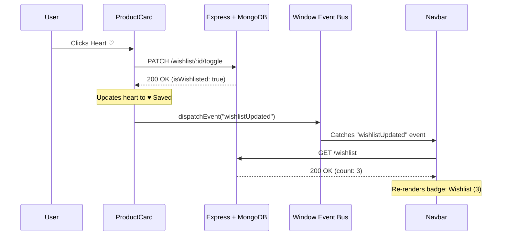

# ShopKart Wishlist System (Lab 04) — Complete Concepts & Architecture Guide

This comprehensive guide breaks down **every single concept, database relationship, security pattern, population query, event-driven state synchronization technique, and architectural principle** used to build the ShopKart Wishlist system. It is designed to take you from fundamentals to total conceptual mastery so you can explain every detail with confidence in your lab evaluations, technical code reviews, and viva interviews.

---

## Table of Contents
1. [The Architecture of E-Commerce Wishlists: References vs Embedding](#1-the-architecture-of-e-commerce-wishlists-references-vs-embedding)
2. [MongoDB Relationships & ObjectId Mechanics (`ref` & `ObjectId[]`)](#2-mongodb-relationships--objectid-mechanics-ref--objectid)
3. [The Power of Mongoose `populate()`: Dynamic Graph Resolution](#3-the-power-of-mongoose-populate-dynamic-graph-resolution)
4. [Protected REST API Security: User Identity via JWT Session](#4-protected-rest-api-security-user-identity-via-jwt-session)
5. [Duplicate Prevention & Concurrency Handling (`409 Conflict`)](#5-duplicate-prevention--concurrency-handling-409-conflict)
6. [Data Normalization & The Single Source of Truth Principle](#6-data-normalization--the-single-source-of-truth-principle)
7. [Full Backend API Contract & Implementation](#7-full-backend-api-contract--implementation)
8. [Cross-Component State Synchronization without Heavy State Libraries](#8-cross-component-state-synchronization-without-heavy-state-libraries)
9. [Frontend Architecture: ProductCard, WishlistCard & The 3 UI States](#9-frontend-architecture-productcard-wishlistcard--the-3-ui-states)
10. [Defensive Engineering: Handling Orphaned References & ID Validation](#10-defensive-engineering-handling-orphaned-references--id-validation)
11. [Bonus Architectural Features: Atomic Toggle & Real-Time Navbar Counter](#11-bonus-architectural-features-atomic-toggle--real-time-navbar-counter)
12. [TA Evaluation Rubric, Edge Cases & Comprehensive Viva Q&A](#12-ta-evaluation-rubric-edge-cases--comprehensive-viva-qa)

---

## 1. The Architecture of E-Commerce Wishlists: References vs Embedding

In MongoDB, document modeling boils down to two opposing design patterns: **Embedding (Denormalization)** and **Referencing (Normalization)**.

### 1.1 The Anti-Pattern: Embedding Products in the User Document
Beginner developers often make the mistake of duplicating the entire product object directly inside the user's wishlist array:

```javascript
// ❌ WRONG: Embedding product copies inside the User document
{
  "_id": ObjectId("66d1001"),
  "fullName": "Surya Rawat",
  "wishlist": [
    {
      "name": "Noise Cancelling Headphones",
      "price": 4999,
      "category": "Electronics",
      "stock": 25,
      "image": "https://..."
    }
  ]
}
```

#### Why Embedding Fails in Production:
1. **Data Stale / Drift Problem**: If an admin updates the product price from ₹4,999 to ₹3,999 or changes the inventory stock, the customer's wishlist still displays the old ₹4,999 price.
2. **Double Updates**: To keep data synchronized, updating a single product price would require running a multi-document update across thousands of user documents in the database.
3. **Unbounded Document Growth**: In MongoDB, documents have a hard size limit of 16MB. Embedding complete objects into arrays causes document bloat and slower read/write cycles.

---

### 1.2 The Production Pattern: Referencing Product ObjectIds
In Lab 04, we use **Normalized Referencing**:

```javascript
// ✅ CORRECT: Normalized ObjectId References
{
  "_id": ObjectId("66d1001"),
  "fullName": "Surya Rawat",
  "wishlist": [
    ObjectId("6ab622da24ae0904eee9cc3b"),
    ObjectId("6ab61f2824ae0904eee9cc3a")
  ]
}
```

```text
Customer Document
┌───────────────────────────────┐
│ _id: 66d1001                  │
│ fullName: "Surya Rawat"       │
│ wishlist: [                   │
│   ObjectId("6ab6...3b") ──────┼───────┐
│   ObjectId("6ab6...3a") ──────┼───┐   │
│ ]                             │   │   │
└───────────────────────────────┘   │   │
                                    │   │
  Product Collection                │   │
  ┌─────────────────────────────────┴─┐ │
  │ _id: ObjectId("6ab6...3b")        │ │
  │ name: "Apple Watch Series 9"      │ │
  │ price: 41900                      │ │
  │ stock: 15 (Single Source of Truth)│ │
  └───────────────────────────────────┘ │
                                        │
  ┌─────────────────────────────────────┴─┐
  │ _id: ObjectId("6ab6...3a")            │
  │ name: "Nike Air Max 270"              │
  │ price: 12995                          │
  └───────────────────────────────────────┘
```

#### Why Referencing Wins:
- **Single Source of Truth**: When the price, stock, or image of a product changes in the `products` collection, any user fetching their wishlist immediately gets the latest data.
- **Minimal Storage**: An `ObjectId` requires only 12 bytes of storage. An array of 100 wishlisted items takes only 1.2 KB instead of megabytes of duplicated product text and metadata.

---

## 2. MongoDB Relationships & ObjectId Mechanics (`ref` & `ObjectId[]`)

### 2.1 Extending the Customer Schema ([`backend/models/customer.model.js`](file:///d:/Codes/Mern/shopkart%20PROJECT/backend/models/customer.model.js))

To establish a relationship between `Customer` and `Product`, Mongoose provides the `Schema.Types.ObjectId` data type and the `ref` option:

```javascript
import mongoose from 'mongoose'

const customerSchema = new mongoose.Schema(
    {
        fullName: { type: String, required: true, trim: true },
        email: { type: String, required: true, unique: true, lowercase: true, trim: true },
        password: { type: String, required: true },
        phone: { type: String, required: true, trim: true },
        
        // MongoDB 1-to-N Reference
        wishlist: [
            {
                type: mongoose.Schema.Types.ObjectId,
                ref: 'Product' // The model name Mongoose will query during populate()
            }
        ]
    },
    {
        timestamps: true
    }
)

const Customer = mongoose.model('Customer', customerSchema)
export default Customer
```

### 2.2 Deep Dive: What Does `ref: 'Product'` Actually Do?
1. In raw MongoDB, an `ObjectId` is merely a 12-byte binary value. MongoDB itself does **not** enforce foreign key constraints out of the box.
2. The `ref: 'Product'` string tells Mongoose:
   > *"When the developer invokes `.populate('wishlist')`, look at the model registered under the name `'Product'` and query its collection for documents whose `_id` matches the stored ObjectIds."*
3. Without `ref`, `.populate()` throws an error because Mongoose would not know which collection to look up.

---

## 3. The Power of Mongoose `populate()`: Dynamic Graph Resolution

### 3.1 Under the Hood: How `populate()` Executes
When client code runs:
```javascript
const customer = await Customer.findById(req.user._id).populate({
    path: 'wishlist',
    select: 'name price category image stock description'
})
```

Mongoose executes a two-step query sequence behind the scenes:
1. **Query 1**: Finds the user document by `_id`:
   ```sql
   db.customers.findOne({ _id: ObjectId("...") })
   ```
   *Result returned*: `wishlist = [ ObjectId("6ab6...3b"), ObjectId("6ab6...3a") ]`
2. **Query 2**: Gathers all `ObjectId` values and executes a batch lookup in the `products` collection using the `$in` operator:
   ```sql
   db.products.find({ 
     _id: { $in: [ ObjectId("6ab6...3b"), ObjectId("6ab6...3a") ] } 
   }, { name: 1, price: 1, category: 1, image: 1, stock: 1, description: 1 })
   ```
3. **Graph Stitching**: Mongoose replaces the array of raw `ObjectId` strings in the `customer.wishlist` array with the resulting hydrated product documents.

### 3.2 Selective Projection (`select`)
Notice the `select` option in our populate call:
```javascript
select: 'name price category image stock description'
```
This is a critical security and performance practice:
- It excludes heavy, unneeded metadata (such as internal version keys `__v`, internal admin flags, supplier data, etc.).
- It saves server memory and network serialization overhead.

---

## 4. Protected REST API Security: User Identity via JWT Session

### 4.1 The Security Vulnerability: Never Accept `userId` from the Request Body
Consider this dangerous implementation:

```javascript
// 🚨 CRITICAL SECURITY VULNERABILITY (IDOR - Insecure Direct Object Reference)
app.post('/wishlist', async (req, res) => {
    const { userId, productId } = req.body // Attacker can supply ANY user's ID!
    await Customer.findByIdAndUpdate(userId, { $push: { wishlist: productId } })
})
```

If the API accepts `userId` from the client:
- An attacker can inspect requests, substitute another user's `userId`, and manipulate, view, or erase any stranger's wishlist.
- This breaks user isolation and violates OWASP Top 10 security standards.

### 4.2 The Secure Architecture: Trusting the Authenticated JWT
In ShopKart, our authentication middleware ([`backend/middlewares/auth.middleware.js`](file:///d:/Codes/Mern/shopkart%20PROJECT/backend/middlewares/auth.middleware.js)) extracts and verifies the cryptographically signed JWT token:

```text
HTTP Request (HttpOnly Cookie or Authorization: Bearer <token>)
                           │
                           ▼
             isAuthenticated Middleware
          ┌───────────────────────────────────┐
          │ 1. Verify token signature with    │
          │    process.env.JWT_SECRET         │
          │ 2. Decode payload: { id: "..." }  │
          │ 3. Fetch user from DB             │
          │ 4. Attach: req.user = customer    │
          └───────────────────────────────────┘
                           │
                           ▼
            Wishlist Controller Endpoint
          ┌───────────────────────────────────┐
          │ req.user._id is cryptographically │
          │ guaranteed to be the true caller! │
          └───────────────────────────────────┘
```

The user identity is **derived entirely from the verified token**. The client cannot spoof their own identity.

---

## 5. Duplicate Prevention & Concurrency Handling (`409 Conflict`)

### 5.1 Why Duplicates Break E-Commerce UX
If a customer clicks the "Wishlist" button multiple times rapidly, an unprotected system would push the same `productId` multiple times:
```javascript
wishlist: [ "prod1", "prod1", "prod1" ]
```
This causes:
- Duplicate product cards rendered on the `/wishlist` page.
- Inaccurate wishlist counters in the navigation bar.
- Confusing deletion behavior (removing one leaves other ghost duplicates).

### 5.2 Duplicate Detection Logic ([`backend/controllers/wishlist.controller.js`](file:///d:/Codes/Mern/shopkart%20PROJECT/backend/controllers/wishlist.controller.js#L36-L45))

```javascript
// Check for duplicates in wishlist
const alreadyWishlisted = customer.wishlist.some(
    (id) => id.toString() === productId
)

if (alreadyWishlisted) {
    return res.status(409).json({
        success: false,
        message: 'Product already in wishlist'
    })
}
```

#### Why `id.toString() === productId`?
In MongoDB and Mongoose, items stored in `customer.wishlist` are instances of `mongoose.Types.ObjectId`.
In JavaScript:
```javascript
new ObjectId("66d123") === new ObjectId("66d123") // false! (Different object references in heap memory)
```
Comparing two ObjectIds directly with `===` compares memory pointers, which always evaluates to `false`!
Calling `.toString()` converts both to identical hexadecimal strings before comparison.

#### Why HTTP Status Code 409 Conflict?
- `400 Bad Request`: Used for malformed data (e.g., non-hexadecimal ID).
- `404 Not Found`: Used when the product or user does not exist.
- `409 Conflict`: Specifically designed in the HTTP specification for requests that cannot be completed because they conflict with the current state of the resource (e.g., trying to add an entity that already exists).

---

## 6. Data Normalization & The Single Source of Truth Principle

To understand why this architecture is industry standard, compare what happens during product modifications:

```text
Action: Admin marks "Apple Watch Series 9" Out of Stock (stock: 0)
```

| Architecture | Database Action | User Experience on Wishlist Page |
|---|---|---|
| **Embedded (Wrong)** | Admin updates `Product` collection. User's embedded copy in `Customer.wishlist` is **not updated**. | User still sees "15 units left". When they click Buy, checkout fails unexpectedly. |
| **Referenced (ShopKart)** | Admin updates `Product` collection. User's `wishlist` holds only the `ObjectId`. | User's next `GET /wishlist` populates the live product. Badge immediately displays **"Out of Stock"** in real time! |

---

## 7. Full Backend API Contract & Implementation

All wishlist endpoints are grouped into [`backend/routes/wishlist.routes.js`](file:///d:/Codes/Mern/shopkart%20PROJECT/backend/routes/wishlist.routes.js) and protected with `isAuthenticated`:

### 7.1 API Summary Table

| Method | Endpoint | Status Codes | Description |
|---|---|:---:|---|
| **`GET`** | `/wishlist` | `200`, `401` | Returns populated wishlist products for authenticated user. |
| **`POST`** | `/wishlist/:productId` | `201`, `400`, `401`, `404`, `409` | Adds product reference to user's wishlist. |
| **`DELETE`** | `/wishlist/:productId` | `200`, `400`, `401`, `404` | Removes product reference from user's wishlist. |
| **`PATCH`** | `/wishlist/:productId/toggle` | `200`, `400`, `401`, `404` | Atomically adds if missing, or removes if present. |

---

### 7.2 Controller Implementations

#### 1. Add to Wishlist (`POST /wishlist/:productId`)
```javascript
export const addToWishlist = async (req, res) => {
    try {
        const { productId } = req.params

        // 1. Validate ID format
        if (!mongoose.Types.ObjectId.isValid(productId)) {
            return res.status(400).json({ success: false, message: 'Invalid product ID' })
        }

        // 2. Validate product exists in DB
        const product = await Product.findById(productId)
        if (!product) {
            return res.status(404).json({ success: false, message: 'Product not found' })
        }

        // 3. Find authenticated customer
        const customer = await Customer.findById(req.user._id)

        // 4. Check for duplicates
        const alreadyWishlisted = customer.wishlist.some(
            (id) => id.toString() === productId
        )
        if (alreadyWishlisted) {
            return res.status(409).json({ success: false, message: 'Product already in wishlist' })
        }

        // 5. Add and save
        customer.wishlist.push(productId)
        await customer.save()

        return res.status(201).json({ success: true, message: 'Product added to wishlist' })
    } catch (error) {
        return res.status(500).json({ success: false, message: error.message })
    }
}
```

#### 2. Get Wishlist (`GET /wishlist`)
```javascript
export const getWishlist = async (req, res) => {
    try {
        const customer = await Customer.findById(req.user._id).populate({
            path: 'wishlist',
            select: 'name price category image stock description'
        })

        // Defensive check: filter out deleted/orphaned products
        const validWishlist = (customer.wishlist || []).filter((item) => item !== null)

        return res.status(200).json({
            success: true,
            count: validWishlist.length,
            wishlist: validWishlist
        })
    } catch (error) {
        return res.status(500).json({ success: false, message: error.message })
    }
}
```

#### 3. Remove from Wishlist (`DELETE /wishlist/:productId`)
```javascript
export const removeFromWishlist = async (req, res) => {
    try {
        const { productId } = req.params

        if (!mongoose.Types.ObjectId.isValid(productId)) {
            return res.status(400).json({ success: false, message: 'Invalid product ID' })
        }

        const customer = await Customer.findById(req.user._id)

        const isInWishlist = customer.wishlist.some(
            (id) => id.toString() === productId
        )
        if (!isInWishlist) {
            return res.status(404).json({ success: false, message: 'Product not in wishlist' })
        }

        customer.wishlist = customer.wishlist.filter(
            (id) => id.toString() !== productId
        )
        await customer.save()

        return res.status(200).json({ success: true, message: 'Product removed from wishlist' })
    } catch (error) {
        return res.status(500).json({ success: false, message: error.message })
    }
}
```

#### 4. Atomic Toggle (`PATCH /wishlist/:productId/toggle`)
```javascript
export const toggleWishlist = async (req, res) => {
    try {
        const { productId } = req.params

        if (!mongoose.Types.ObjectId.isValid(productId)) {
            return res.status(400).json({ success: false, message: 'Invalid product ID' })
        }

        const product = await Product.findById(productId)
        if (!product) {
            return res.status(404).json({ success: false, message: 'Product not found' })
        }

        const customer = await Customer.findById(req.user._id)
        const index = customer.wishlist.findIndex((id) => id.toString() === productId)

        if (index > -1) {
            // Already saved: Remove it
            customer.wishlist.splice(index, 1)
            await customer.save()
            return res.status(200).json({
                success: true,
                isWishlisted: false,
                message: 'Product removed from wishlist'
            })
        } else {
            // Not saved: Add it
            customer.wishlist.push(productId)
            await customer.save()
            return res.status(200).json({
                success: true,
                isWishlisted: true,
                message: 'Product added to wishlist'
            })
        }
    } catch (error) {
        return res.status(500).json({ success: false, message: error.message })
    }
}
```

---

## 8. Cross-Component State Synchronization without Heavy State Libraries

### 8.1 The Lab 04 Architectural Constraint
Lab 04 explicitly states:
> *"This lab is intentionally placed before Context API / Redux. Do not solve the core requirement using Redux, Context API or another global state-management library."*

This introduces a real-world frontend dilemma:
- `Navbar.jsx` lives in the header.
- `ProductCard.jsx` lives inside the catalog grid.
- `WishlistCard.jsx` lives on the `/wishlist` page.
- How can the Navbar badge update its saved count in real-time when a user clicks the heart icon on a card without page refreshes or bloated libraries?

### 8.2 The Solution: Browser Custom Events
We use the native, standard DOM **CustomEvent** pattern:



#### Dispatcher in `ProductCard.jsx` & `ProductDetails.jsx`:
```javascript
window.dispatchEvent(new CustomEvent('wishlistUpdated'))
```

#### Receiver in `Navbar.jsx` ([`frontend/src/components/Navbar.jsx`](file:///d:/Codes/Mern/shopkart%20PROJECT/frontend/src/components/Navbar.jsx#L26-L40)):
```javascript
useEffect(() => {
    fetchWishlistCount()

    const handleWishlistUpdated = (e) => {
        if (e?.detail?.count !== undefined) {
            setWishlistCount(e.detail.count)
        } else {
            fetchWishlistCount() // Re-fetch verified count from MongoDB
        }
    }

    window.addEventListener('wishlistUpdated', handleWishlistUpdated)
    return () => {
        window.removeEventListener('wishlistUpdated', handleWishlistUpdated)
    }
}, [user])
```

#### Why This Approach is Superior:
1. **Adheres 100% to Lab Constraints**: No external state managers or Redux stores required.
2. **Decoupled**: Components don't need prop-drilling or knowledge of each other.
3. **Memory Leak Free**: The cleanup function in `useEffect` removes the listener on component unmount.
4. **Backend-Verified**: The badge count reflects true MongoDB state rather than optimistic guesswork.

---

## 9. Frontend Architecture: ProductCard, WishlistCard & The 3 UI States

### 9.1 ProductCard Architecture ([`frontend/src/components/ProductCard.jsx`](file:///d:/Codes/Mern/shopkart%20PROJECT/frontend/src/components/ProductCard.jsx))
- **Floating Heart Action**: Absolute positioning in the top-right overlay of the product image (`absolute top-2.5 right-2.5`).
- **In-Flight Lock**: `disabled={isSaving}` prevents double-clicking and spamming requests while an HTTP round-trip is resolving.
- **Dynamic Feedback**:
  - Idle (Not Saved): `♡`
  - In-Flight: Circular SVG spinner
  - Saved: Solid `♥` in Rose-500 styling
- **Bottom Action**: Clean, full-width **View Details** button leading to `/products/:id`.

### 9.2 WishlistCard Architecture ([`frontend/src/components/WishlistCard.jsx`](file:///d:/Codes/Mern/shopkart%20PROJECT/frontend/src/components/WishlistCard.jsx))
- Displays formatted Indian Rupee pricing (`₹{product.price.toLocaleString('en-IN')}`).
- Dynamic stock badge:
  - `stock <= 0`: Red **Out of Stock** badge.
  - `stock <= 5`: Amber warning badge (*"X units left"*).
  - `stock > 5`: Green **In Stock** badge.
- Dual action grid: **View Details** (React Router `<Link>`) + **Remove** button (triggers DELETE API with spinner feedback).

### 9.3 The 3 Mandatory Interaction States in `Wishlist.jsx` ([`frontend/src/pages/Wishlist.jsx`](file:///d:/Codes/Mern/shopkart%20PROJECT/frontend/src/pages/Wishlist.jsx))

```text
┌────────────────────────────────────────────────────────┐
│ State 1: LOADING                                       │
│ ┌────────────────────────────────────────────────────┐ │
│ │                  (Spinner)                         │ │
│ │          Loading your wishlist...                  │ │
│ └────────────────────────────────────────────────────┘ │
├────────────────────────────────────────────────────────┤
│ State 2: ERROR                                         │
│ ┌────────────────────────────────────────────────────┐ │
│ │                     [ ! ]                          │ │
│ │             Something went wrong.                  │ │
│ │        We couldn't load your wishlist.             │ │
│ │                  [ Try Again ]                     │ │
│ └────────────────────────────────────────────────────┘ │
├────────────────────────────────────────────────────────┤
│ State 3: EMPTY                                         │
│ ┌────────────────────────────────────────────────────┐ │
│ │                      ❤️                            │ │
│ │            Your wishlist is empty                  │ │
│ │    Save products you love and find them here later │ │
│ │              [ Browse Products ]                   │ │
│ └────────────────────────────────────────────────────┘ │
└────────────────────────────────────────────────────────┘
```

1. **Loading State**: Shown when `loading === true`. Prevents layout shifts or broken empty cards from flashing before the server responds.
2. **Error State**: Shown when `!loading && error`. Never leaves the user stranded; features a **Try Again** button that triggers `fetchWishlist()`.
3. **Empty State**: Shown when `!loading && !error && wishlist.length === 0`. Guides the user back into the conversion funnel with a **Browse Products** CTA button linking to `/products`.

---

## 10. Defensive Engineering: Handling Orphaned References & ID Validation

### 10.1 The Orphaned Reference Gotcha (Null Populate References)
Suppose a customer saves Product A (`66d...`). Later, an admin completely deletes Product A from the `Product` collection.
When the user calls `GET /wishlist`, Mongoose populates the array:
```javascript
// Raw populated result from Mongoose:
customer.wishlist = [
    { _id: "66d1", name: "Keyboard", price: 2999 },
    null // ⚠️ The deleted product resolves to null!
]
```
If your frontend attempts to render:
```jsx
{wishlist.map(product => (
    <h3>{product.name}</h3> // 💥 CRASH: Cannot read properties of null (reading 'name')
))}
```
#### Our Defense ([`backend/controllers/wishlist.controller.js`](file:///d:/Codes/Mern/shopkart%20PROJECT/backend/controllers/wishlist.controller.js#L86)):
```javascript
const validWishlist = (customer.wishlist || []).filter((item) => item !== null)
```
This guarantees that the API response array only ever contains valid, intact product documents.

### 10.2 Strict MongoDB ObjectId Validation
Before querying Mongoose, our controllers always check:
```javascript
if (!mongoose.Types.ObjectId.isValid(productId)) {
    return res.status(400).json({ success: false, message: 'Invalid product ID' })
}
```
This prevents unhandled Mongoose `CastError` exceptions that would otherwise produce ugly `500 Internal Server Error` responses.

---

## 11. Bonus Architectural Features: Atomic Toggle & Real-Time Navbar Counter

### 11.1 Atomic Toggle Action (Bonus Challenge — +10 Marks)
Traditional CRUD requires the frontend to track whether a product is wishlisted and choose between `POST` or `DELETE`.
Our `PATCH /wishlist/:productId/toggle` endpoint makes the operation **atomic and idempotent**:
- The server checks existence in the array.
- If present, it deletes and returns `{ isWishlisted: false }`.
- If absent, it inserts and returns `{ isWishlisted: true }`.
- This eliminates frontend race conditions and simplifies UI event handlers to a single function call.

### 11.2 Real-Time Navbar Counter (Bonus Challenge — +5 Marks)
- In [`Navbar.jsx`](file:///d:/Codes/Mern/shopkart%20PROJECT/frontend/src/components/Navbar.jsx), the Wishlist navigation item dynamically shows the live count:
  ```jsx
  <Link to="/wishlist" className="...">
    <span>Wishlist</span>
    {wishlistCount !== null && (
      <span className="rounded-full bg-rose-50 border border-rose-200/60 px-1.5 py-0.2 text-[10px] font-bold text-rose-600">
        {wishlistCount}
      </span>
    )}
  </Link>
  ```
- The count is fetched on authentication mount and kept synchronized across pages via the custom window event listener.

---

## 12. TA Evaluation Rubric, Edge Cases & Comprehensive Viva Q&A

### 12.1 Evaluation Rubric (100 Marks + 15 Bonus)

| Component | Marks | Verification in Codebase |
|---|:---:|---|
| **User Schema & MongoDB Relationship** | 15 | [`customer.model.js`](file:///d:/Codes/Mern/shopkart%20PROJECT/backend/models/customer.model.js) — `wishlist: [{ type: ObjectId, ref: 'Product' }]`. |
| **Add Wishlist API** | 15 | `POST /wishlist/:productId` with ObjectId check, product verification & `409 Conflict`. |
| **Get Wishlist API + populate** | 20 | `GET /wishlist` with `.populate({ path: 'wishlist' })` and null filter. |
| **Remove Wishlist API** | 10 | `DELETE /wishlist/:productId` with `$pull` / array filter and `404` verification. |
| **Product Card Integration** | 10 | [`ProductCard.jsx`](file:///d:/Codes/Mern/shopkart%20PROJECT/frontend/src/components/ProductCard.jsx) — floating heart action with saving state & duplicate lock. |
| **Wishlist Page** | 15 | [`Wishlist.jsx`](file:///d:/Codes/Mern/shopkart%20PROJECT/frontend/src/pages/Wishlist.jsx) — dynamic grid with [`WishlistCard.jsx`](file:///d:/Codes/Mern/shopkart%20PROJECT/frontend/src/components/WishlistCard.jsx). |
| **Loading / Empty / Error States** | 5 | All 3 states cleanly implemented with spinners and retry/browse CTA buttons. |
| **Code Quality & Separation of Concerns** | 5 | Clean architecture, centralized Axios service, no code duplication. |
| **Viva** | 5 | Conceptual defense of questions below. |
| **⭐ Bonus: Wishlist Toggle** | **+10** | `PATCH /wishlist/:productId/toggle` endpoint and frontend toggle integration. |
| **⭐ Bonus: Dynamic Navbar Count** | **+5** | Live counter badge in [`Navbar.jsx`](file:///d:/Codes/Mern/shopkart%20PROJECT/frontend/src/components/Navbar.jsx) synchronized via event bus. |
| **TOTAL** | **115 / 100** | |

---

### 12.2 Comprehensive Viva Questions & Model Answers

#### Q1: Why are we storing ObjectIds instead of embedding complete Product objects inside the Customer model?
> **Answer**: Embedding products violates the Single Source of Truth principle. If a product's price, stock, or image changes in the catalog, embedded copies inside thousands of user documents become instantly stale and out-of-date. Storing normalized `ObjectId` references guarantees that whenever the user views their wishlist, the latest, real-time product information is fetched from the Product collection via `.populate()`. It also minimizes document size and database storage.

#### Q2: What does `ref: 'Product'` in the Mongoose schema actually do?
> **Answer**: It tells Mongoose which registered model to target when resolving relationships during a `.populate()` query. Without `ref`, Mongoose only sees raw 12-byte hex strings and does not know which database collection to join against.

#### Q3: What is the difference between embedding and referencing in MongoDB, and when should you use each?
> **Answer**:
> - **Embedding** stores related data directly inside the parent document. It is optimal for 1-to-few relationships where data is tightly coupled, rarely modified independently, and always read together (e.g., street addresses inside a user profile).
> - **Referencing** stores only the `_id` of related documents. It is optimal for 1-to-many, many-to-many relationships, or when the referenced entity changes frequently and must remain consistent across multiple parents (e.g., products in wishlists, authors in blog posts).

#### Q4: Why should wishlist endpoints be protected with authentication?
> **Answer**: A wishlist is a private, user-specific resource. Unprotected endpoints would allow unauthenticated visitors or malicious actors to access or alter saved preferences. Protection ensures that only users with a valid, cryptographically signed JWT token can access or manipulate their own wishlist.

#### Q5: Why should the server extract `userId` from the JWT rather than accepting it from `req.body` or URL parameters?
> **Answer**: Accepting `userId` from client input introduces an **Insecure Direct Object Reference (IDOR)** vulnerability. Any user could submit another user's ID and tamper with their private data. Deriving `userId` from the decoded JWT cookie ensures that the identity is verified and tamper-proof.

#### Q6: How does our backend prevent duplicate products in a user's wishlist, and what HTTP status code is returned?
> **Answer**: Before adding an item, the controller checks whether the product ID already exists in the user's wishlist array using `customer.wishlist.some(id => id.toString() === productId)`. If a match is found, the server stops execution and returns **HTTP 409 Conflict**.

#### Q7: Why do we compare ObjectIds using `id.toString() === productId` instead of `id === productId`?
> **Answer**: In JavaScript, ObjectIds are complex objects, not primitive strings. Comparing two objects with `===` checks if they point to the exact same reference in memory, which evaluates to `false` even if they have the exact same hex value. Calling `.toString()` converts both to primitive strings for accurate value equality.

#### Q8: What happens during `populate()` if a wishlisted product was deleted by an admin?
> **Answer**: Mongoose attempts to find the document with that `_id` in the `Product` collection. Because the product no longer exists, Mongoose places `null` at that index in the array. If the server does not handle this, the frontend could crash with a TypeError when trying to access properties of `null`. Our backend protects against this by filtering out nulls: `validWishlist = customer.wishlist.filter(item => item !== null)`.

#### Q9: Why shouldn't we solve the wishlist requirement using Redux or React Context?
> **Answer**: A wishlist is an e-commerce feature that must be **persistent across devices and browser sessions**. If a user logs in on a laptop and saves a product, they expect to see it when they log in on their mobile phone. State in Redux or Context is purely client-side memory that disappears upon page refresh or device switch. The wishlist must be stored in MongoDB and treated as a persistent server resource.

#### Q10: How does our application synchronize the Navbar wishlist counter in real-time without global state management?
> **Answer**: We utilize the browser's native DOM Custom Event system. When any component (`ProductCard`, `ProductDetails`, or `Wishlist`) successfully adds or removes an item via the API, it dispatches a `window.dispatchEvent(new CustomEvent('wishlistUpdated'))`. The `Navbar` component listens for this event with `window.addEventListener('wishlistUpdated', ...)` and automatically queries the backend for the updated count, re-rendering the badge immediately.

#### Q11: Why is an in-flight loading lock (`isSaving`) necessary on the wishlist button?
> **Answer**: Rapid multiple clicks by a user before an HTTP request completes can trigger concurrent requests to the backend (a race condition). Disabling the button while `isSaving === true` prevents duplicate network traffic, avoids redundant server database writes, and provides clear visual feedback to the user.

#### Q12: What are the three interaction states on the Wishlist page, and why are all three required?
> **Answer**:
> 1. **Loading State**: Displays a spinner while the asynchronous API request is pending, preventing confusing layout flashes.
> 2. **Error State**: Displays a helpful error alert with a "Try Again" retry action if the network drops or the server fails.
> 3. **Empty State**: Displays an inviting message with a "Browse Products" call-to-action button when the user has 0 saved items, guiding them back into the shopping flow rather than showing a blank, broken screen.
