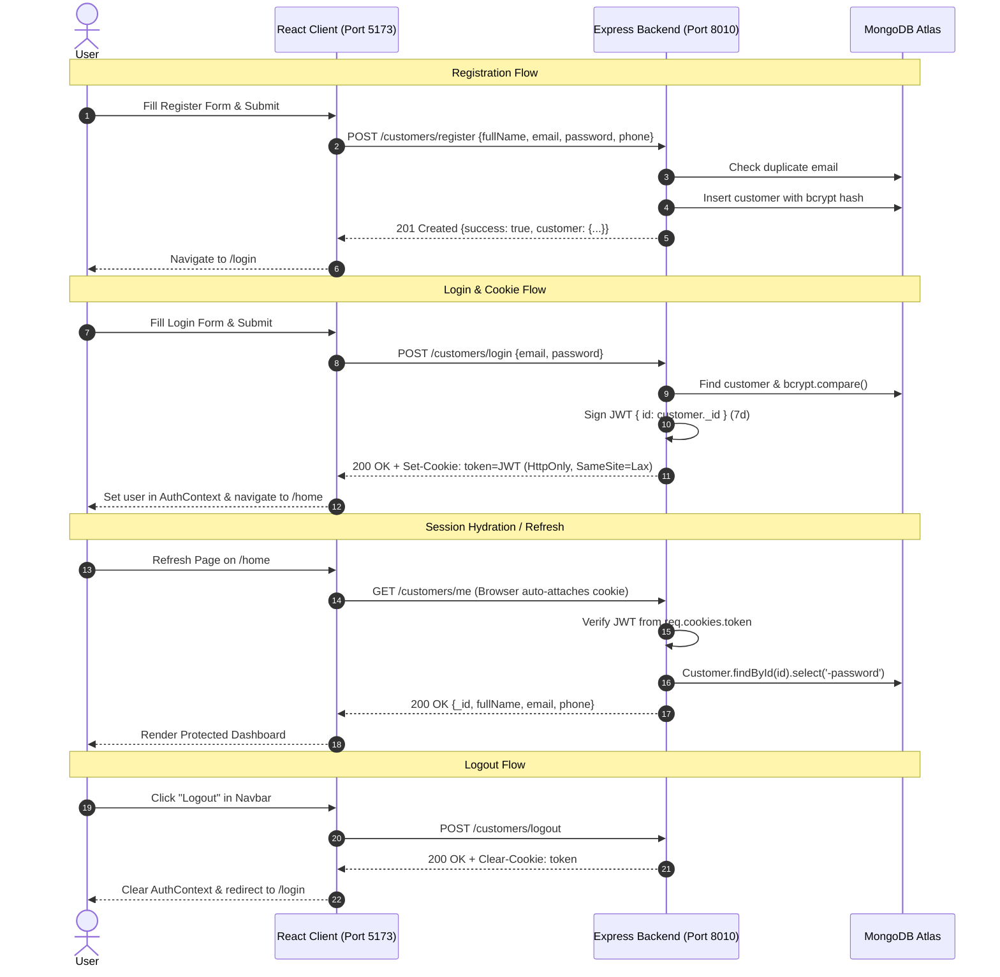

# ShopKart: Complete Lab 01 & Lab 02 Walkthrough

A complete guide to the **ShopKart Customer Authentication Service** — detailing the **Node.js/Express/MongoDB backend (Lab 01)**, the **React/Vite/Tailwind CSS frontend (Lab 02)**, their end-to-end authentication lifecycle, and verification steps.

---

## Table of Contents
1. [Architecture & System Design](#1-architecture--system-design)
2. [Project Structure](#2-project-structure)
3. [Backend Breakdown (Lab 01)](#3-backend-breakdown-lab-01)
4. [Frontend Breakdown (Lab 02)](#4-frontend-breakdown-lab-02)
5. [End-to-End Authentication Lifecycle](#5-end-to-end-authentication-lifecycle)
6. [How to Run the Application Locally](#6-how-to-run-the-application-locally)
7. [Step-by-Step Testing & Verification](#7-step-by-step-testing--verification)
8. [TA Viva Preparation & Key Concepts](#8-ta-viva-preparation--key-concepts)

---

## 1. Architecture & System Design

ShopKart is built as a decoupled client-server architecture with stateful token persistence via **HttpOnly cookies**:



---

## 2. Project Structure

```text
shopkart PROJECT/
├── lab_problemstatements/                   # Lab problem specifications
│   ├── Lab-01 (ShopKart).md
│   ├── Lab-02 (client Server Auth).md
│   └── Lab-03 (Product Catalog).md
│
├── walkthrough/                             # Concepts & walkthrough guides
│   ├── ShopKart-Lab-01-Concepts-Guide.md
│   ├── ShopKart-Lab-02-Concepts-Guide.md
│   └── Walkthrough.md
│
├── backend/                                 # Node.js + Express (Port 8010)
│   ├── .env                                 # PORT, dbUrl, JWT_SECRET
│   ├── index.js                             # Server bootstrap & CORS setup
│   ├── package.json
│   ├── models/
│   │   └── customer.model.js                # Customer Schema (Mongoose)
│   ├── routes/
│   │   └── customer.routes.js               # Route mapping
│   ├── controllers/
│   │   └── customer.controller.js           # Auth business logic
│   ├── middlewares/
│   │   └── auth.middleware.js               # JWT verification middleware
│   └── utils/
│       └── generateToken.js                 # jwt.sign helper
│
└── frontend/                                # Vite + React 19 + Tailwind v4 (Port 5173)
    ├── package.json
    ├── vite.config.js                        # Tailwind Vite plugin
    ├── index.html
    └── src/
        ├── index.css                        # @import "tailwindcss"
        ├── main.jsx                         # Application entry
        ├── App.jsx                          # Router & route guards
        ├── services/
        │   └── api.js                       # Axios with credentials: true
        ├── context/
        │   └── AuthContext.jsx              # Session manager via /customers/me
        ├── components/
        │   ├── Navbar.jsx                   # Brand & Logout button
        │   ├── ProtectedRoute.jsx           # Redirects unauthenticated to /login
        │   └── PublicRoute.jsx              # Redirects logged-in to /home
        └── pages/
            ├── Register.jsx                 # Controlled registration form
            ├── Login.jsx                    # Controlled login form
            ├── Profile.jsx                  # Customer profile page
            ├── Products.jsx                 # Product discovery catalog (Lab 03)
            ├── ProductDetails.jsx           # Product details view (Lab 03)
            └── Home.jsx                     # Redirect to /profile
```

---

## 3. Backend Breakdown (Lab 01)

### 3.1 Mongoose Customer Schema
Located at [`backend/models/customer.model.js`](file:///d:/Codes/Mern/shopkart%20PROJECT/backend/models/customer.model.js):
- **`fullName`**: `String`, required, trimmed.
- **`email`**: `String`, required, unique, lowercase, trimmed.
- **`password`**: `String`, required (stores 60-character bcrypt hash).
- **`phone`**: `String`, required, trimmed.
- **`timestamps`**: Automatic `createdAt` and `updatedAt`.

### 3.2 Authentication Middleware
Located at [`backend/middlewares/auth.middleware.js`](file:///d:/Codes/Mern/shopkart%20PROJECT/backend/middlewares/auth.middleware.js):
1. Reads `req.cookies?.token`. If absent, immediately returns `401 Unauthorized - No token provided`.
2. Verifies the token against `process.env.JWT_SECRET`.
3. Finds the customer in MongoDB: `Customer.findById(decoded.id).select('-password')`.
4. Attaches customer to `req.user` and calls `next()` to hand execution to the controller.

### 3.3 Endpoints Summary
| Method | Route | Protection | Handler | Description |
| :--- | :--- | :---: | :--- | :--- |
| `POST` | `/customers/register` | ❌ | [`registerCustomer`](file:///d:/Codes/Mern/shopkart%20PROJECT/backend/controllers/customer.controller.js#L15) | Validates fields, hashes password with `bcrypt.genSalt(10)`, saves customer. |
| `POST` | `/customers/login` | ❌ | [`loginCustomer`](file:///d:/Codes/Mern/shopkart%20PROJECT/backend/controllers/customer.controller.js#L66) | Compares password, signs JWT, sets `HttpOnly` cookie. |
| `GET` | `/customers/me` | ✅ | [`getCustomerProfile`](file:///d:/Codes/Mern/shopkart%20PROJECT/backend/controllers/customer.controller.js#L111) | Returns `{ _id, fullName, email, phone }` from `req.user`. |
| `POST` | `/customers/logout` | ✅ | [`logoutCustomer`](file:///d:/Codes/Mern/shopkart%20PROJECT/backend/controllers/customer.controller.js#L128) | Clears `token` cookie with matching options. |
| `PATCH` | `/customers/change-password` | ✅ | [`changePassword`](file:///d:/Codes/Mern/shopkart%20PROJECT/backend/controllers/customer.controller.js#L149) | Verifies old password, hashes new password, saves customer (+10 Bonus). |

---

## 4. Frontend Breakdown (Lab 02)

### 4.1 Axios Centralized Service
Located at [`frontend/src/services/api.js`](file:///d:/Codes/Mern/shopkart%20PROJECT/frontend/src/services/api.js):
```javascript
export const api = axios.create({
  baseURL: 'http://localhost:8010',
  headers: { 'Content-Type': 'application/json' },
  withCredentials: true, // MANDATORY: Sends HttpOnly cookies on cross-origin requests
})
```

### 4.2 AuthContext & Session Hydration
Located at [`frontend/src/context/AuthContext.jsx`](file:///d:/Codes/Mern/shopkart%20PROJECT/frontend/src/context/AuthContext.jsx):
- On initial mount, triggers `api.get('/customers/me')`.
- If the browser holds a valid cookie, `user` state is populated with customer profile data.
- If no cookie exists or verification fails, `user` is set to `null`.
- `loading` ensures route guards wait until session verification completes before redirecting.

### 4.3 Route Guards
- [`ProtectedRoute.jsx`](file:///d:/Codes/Mern/shopkart%20PROJECT/frontend/src/components/ProtectedRoute.jsx): Blocks access to `/home` if `!user`, redirecting to `/login`.
- [`PublicRoute.jsx`](file:///d:/Codes/Mern/shopkart%20PROJECT/frontend/src/components/PublicRoute.jsx): Redirects authenticated users from `/login` or `/register` to `/home`.

### 4.4 Pages
- **[`Register.jsx`](file:///d:/Codes/Mern/shopkart%20PROJECT/frontend/src/pages/Register.jsx)**: Full Name, Email, Password, Phone Number. Validates all inputs and enforces password length $\ge 6$. Redirects to `/login` upon success.
- **[`Login.jsx`](file:///d:/Codes/Mern/shopkart%20PROJECT/frontend/src/pages/Login.jsx)**: Email and Password. Handles "Invalid Credentials" errors. On success, updates `AuthContext` and navigates to `/home`.
- **[`Home.jsx`](file:///d:/Codes/Mern/shopkart%20PROJECT/frontend/src/pages/Home.jsx)**: Protected dashboard with welcome banner, user badge, and customer information cards (Name, Email, Phone, Customer ID).
- **[`Navbar.jsx`](file:///d:/Codes/Mern/shopkart%20PROJECT/frontend/src/components/Navbar.jsx)**: Includes the `sk` brand logo, customer greeting, and the "Logout" button that calls `POST /customers/logout`.

---

## 5. End-to-End Authentication Lifecycle

```text
  [ Client Browser ]                              [ Express Backend ]
          │                                                │
          ├─── 1. POST /customers/register ───────────────►│ (Hashes password, saves to DB)
          │◄── 2. 201 Created (Redirects to /login) ───────┤
          │                                                │
          ├─── 3. POST /customers/login ──────────────────►│ (Validates credentials, signs JWT)
          │◄── 4. Set-Cookie: token=... (HttpOnly) ────────┤
          │                                                │
          ├─── 5. GET /customers/me (Cookie attached) ────►│ (Verifies JWT, finds user)
          │◄── 6. 200 OK { user profile data } ────────────┤
          │                                                │
          ├─── 7. POST /customers/logout ─────────────────►│ (Clears token cookie)
          │◄── 8. 200 OK (Redirects to /login) ────────────┤
```

---

## 6. How to Run the Application Locally

### Step 1: Start the Backend
Open a terminal in the backend directory:
```bash
cd "d:\Codes\Mern\shopkart PROJECT\backend"
npm run dev
```
> Server will log: `Server started on port 8010` and `MongoDB Connected successfully`.

### Step 2: Start the Frontend
Open a second terminal in the frontend directory:
```bash
cd "d:\Codes\Mern\shopkart PROJECT\frontend"
npm run dev
```
> Vite will start the frontend at: `http://localhost:5173/`.

---

## 7. Step-by-Step Testing & Verification

Follow this checklist to test all requirements:

### Test 1: User Registration
1. Visit `http://localhost:5173/register`.
2. Try submitting with empty fields $\rightarrow$ Verify error: `"Please fill in all fields."`
3. Try entering a password shorter than 6 characters $\rightarrow$ Verify error: `"Password must be at least 6 characters long."`
4. Enter valid data:
   - **Full Name**: `Jane Doe`
   - **Email**: `jane@shopkart.com`
   - **Password**: `secret123`
   - **Phone**: `9876543210`
5. Click **Create Account** $\rightarrow$ Should automatically redirect to `/login`.

### Test 2: Duplicate Email Protection
1. Go back to `/register` and enter `jane@shopkart.com` again.
2. Submit $\rightarrow$ Verify error banner: `"Customer already exists with this email"` (HTTP 409).

### Test 3: Login Verification
1. Visit `http://localhost:5173/login`.
2. Enter invalid password $\rightarrow$ Verify error banner: `"Invalid credentials"` (HTTP 401).
3. Enter correct credentials:
   - **Email**: `jane@shopkart.com`
   - **Password**: `secret123`
4. Click **Login** $\rightarrow$ Redirects to `/home`.

### Test 4: Protected Route & Session Persistence
1. On `/home`, check that **Jane Doe**, **jane@shopkart.com**, and **9876543210** are displayed.
2. Open Chrome DevTools $\rightarrow$ **Application** $\rightarrow$ **Cookies** $\rightarrow$ `http://localhost:8010`.
   - Verify cookie name: `token`.
   - Verify `HttpOnly` flag is checked.
3. Refresh the page on `/home` $\rightarrow$ The user remains logged in (session hydration via `/customers/me`).
4. Manually try to navigate to `http://localhost:5173/login` in the URL bar $\rightarrow$ `PublicRoute` redirects you back to `/home`.

### Test 5: Logout Flow
1. Click the **Logout** button in the Navbar.
2. Verify you are redirected to `/login`.
3. Check Cookies in DevTools $\rightarrow$ `token` cookie has been cleared.
4. Try manually navigating to `http://localhost:5173/home` $\rightarrow$ `ProtectedRoute` blocks access and redirects to `/login`.

---

## 8. TA Viva Preparation & Key Concepts

| Question | Recommended Viva Answer |
| :--- | :--- |
| **1. Why do we use `withCredentials: true` in Axios?** | By default, browser CORS policy blocks cross-origin requests from sending or receiving cookies. Setting `withCredentials: true` instructs the browser to include cookies (such as our HttpOnly JWT) in cross-origin HTTP requests. |
| **2. Why can't JavaScript read an `HttpOnly` cookie?** | The `HttpOnly` flag is a browser security measure that blocks access to `document.cookie` from client-side scripts. This protects authentication sessions from Cross-Site Scripting (XSS) attacks. |
| **3. Why is `/home` called a protected route?** | It is guarded by authentication middleware on both client and server. Access is allowed only if a verified, unexpired session token is present. Unauthenticated requests are rejected. |
| **4. Why do we fetch `/customers/me` instead of storing the user in `localStorage`?** | `localStorage` is completely vulnerable to XSS token theft and can fall out of sync with backend status. Fetching `/customers/me` validates the token against MongoDB as the authoritative source of truth. |
| **5. Why do we use bcrypt hashing instead of encrypting passwords?** | Encryption is two-way (can be decrypted with a secret key). If the server or key leaks, all passwords leak. `bcrypt` is a one-way cryptographic hash with salt and cost factors, making it impossible to reverse even if the database is compromised. |
